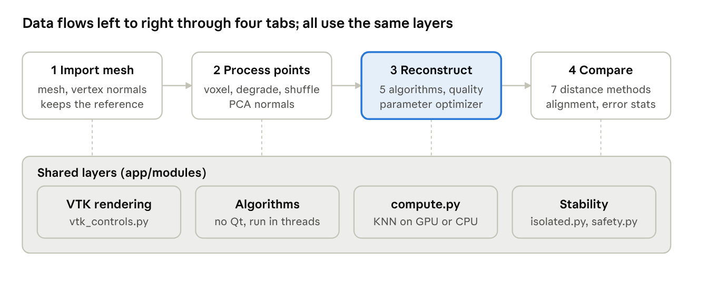

<div dir="rtl">

# گزارش جامع برنامه Model Reconstruction

> تاریخ: 2026-11-15 · به‌روزرسانی: 2026-11-16

## ۱. مقدمه و معماری کلی

Model Reconstruction یک برنامه‌ی دسکتاپ PyQt5 است که از یک ابر نقاط (point cloud) سطح سه‌بعدی پیوسته (مش مثلثی) می‌سازد، کیفیت آن را می‌سنجد و آن را با مدل اصلی مقایسه می‌کند. کل کد حدود ۱۱ هزار خط پایتون در `app/main.py` و ۲۶ ماژول در `app/modules/` است.

### جریان کار چهار تب

داده از چپ به راست در چهار تب جریان دارد و هر تب می‌تواند داده را مستقیم از فایل هم بگیرد:

1. **Import mesh** — یک مش (STL، OBJ، PLY، OFF، glTF) یا ابر نقاط را باز می‌کند، رأس‌های آن را همراه نرمال رأس به‌عنوان ابر نقاط می‌فرستد و همین مش به‌عنوان «مرجع» (ground truth) برای تب‌های ۳ و ۴ نگه داشته می‌شود.
2. **Process points** — ابر نقاط را پردازش می‌کند: کاهش چگالی با voxel، بُر زدن، تخریب کنترل‌شده (نویز، حذف نقاط، سوراخ) برای آزمون مقاومت، و تخمین نرمال اگر نرمال نداشته باشد.
3. **Reconstruct** — با یکی از پنج الگوریتم (Poisson، Ball Pivoting، Alpha Shape، RIMLS، Signed Distance) مش می‌سازد، کیفیت را نسبت به مرجع می‌سنجد و بهینه‌ساز پارامترها را اجرا می‌کند.
4. **Compare** — مش بازسازی‌شده را با هفت روش فاصله با مرجع مقایسه می‌کند و آمار خطا و نقشه‌ی رنگی خطا می‌دهد.



هر تب داده را به صورت `PointCloudData` (نقاط، نرمال‌ها، رنگ‌ها و مرجع) به تب بعدی می‌دهد؛ تب ۱ می‌تواند مستقیم به تب ۳ هم بفرستد، و تب ۳ مش و مرجع را با Send to Compare به تب ۴ می‌فرستد. همه‌ی تب‌ها از همان چهار لایه‌ی پایین استفاده می‌کنند.

### لایه‌های نرم‌افزار

| لایه | کتابخانه | نقش در برنامه | فایل‌های اصلی |
| --- | --- | --- | --- |
| رابط کاربری | PyQt5 (Qt 5) | پنجره، تب‌ها، پنل‌ها، دیالوگ‌ها، thread‌ها، ذخیره‌ی تنظیمات | `main.py`، `ui/main.ui`، `theme.py`، `splitters.py`، `settings.py` |
| رندر سه‌بعدی | VTK 9 | نمایش مش و ابر نقاط، دوربین، تعامل با موس، overlay‌ها، اسکرین‌شات | `vtk_controls.py`، `view_settings.py` |
| هندسه‌ی سنگین | Open3D | KD-tree، Poisson، BPA، Alpha، ثبت (registration)، BVH | `poisson_reconstruction.py`، `alignment.py`، `compute.py` |
| محاسبات عددی | NumPy | همه‌ی آرایه‌ها، PCA برداری، آمار | همه‌ی ماژول‌ها |
| پایداری | stdlib | hook خطا، faulthandler، پروسه‌ی کمکی | `safety.py`، `isolated.py` |

### الگوی مشترک تب‌ها

هر تب یک کلاس است (`Geometry`، `Processing`، `PoissonReconstruction`، `Compare`) که از دو mixin ارث می‌برد:

- `TabMixin` در `vtk_controls.py`: viewport سه‌بعدی، کنسول log، دکمه‌ی حذف داده، checkpoint‌ها، پنل Object info.
- `RotationMixin`: شش کنترل دوران و جابه‌جایی (X/Y/Z زاویه و X/Y/Z مکان) که با actor در VTK همگام می‌مانند.

پنجره‌ی اصلی `MainWindow` فقط این تب‌ها را می‌سازد، منوها و نوار وضعیت را تعریف می‌کند و داده را بین تب‌ها پاس می‌دهد (`send_point_cloud`، `send_to_compare`). کار سنگین هرگز روی thread رابط کاربری اجرا نمی‌شود: بازسازی در `QThread`، آمار شیء در `ThreadPoolExecutor` و Poisson در یک پروسه‌ی جدا.

## ۲. مفاهیم پایه‌ی هندسی و فیزیکی

همه‌ی برنامه روی سه نوع داده کار می‌کند: ابر نقاط، نرمال‌ها و مش مثلثی. هر سه آرایه‌های NumPy هستند و واحد طول همان واحد فایل ورودی است (در برنامه «u»، مثلاً میلی‌متر برای یک اسکن صنعتی).

### ۲.۱ ابر نقاط (Point cloud)

ابر نقاط مجموعه‌ای از N نقطه‌ی pᵢ = (xᵢ, yᵢ, zᵢ) است که از سطح یک جسم فیزیکی برداشته شده‌اند (اسکنر لیزری، فتوگرامتری، LiDAR یا نمونه‌برداری از یک مش). در کد یک آرایه‌ی `(N, 3)` از float64 است. ابر نقاط هیچ اطلاعاتی درباره‌ی اتصال نقاط ندارد؛ کار بازسازی دقیقاً یافتن همین اتصال (سطح) است.

کلاس `PointCloudData` در `point_data.py` ظرف مشترک همه‌ی تب‌هاست و این فیلدها را دارد:

| فیلد | شکل | معنا |
| --- | --- | --- |
| `points` | (N, 3) float | مختصات نقاط |
| `normals` | (N, 3) float یا None | بردار یکه‌ی عمود بر سطح در هر نقطه |
| `colors` | (N, 3) در بازه‌ی 0..1 یا None | رنگ RGB خود فایل |
| `reference` | (vertices, triangles) یا None | مش مرجعی که نقاط از آن آمده‌اند |
| `source`, `note` | رشته | نام فایل و شرح تخریب (مثلاً «noise σ=0.5%») |
| `dropped` | int | تعداد سطرهای حذف‌شده به خاطر NaN یا inf |

در `__post_init__` نرمال‌ها یکه می‌شوند، رنگ‌های ناهم‌اندازه کنار گذاشته می‌شوند و سطرهای غیرمتناهی حذف می‌شوند؛ اگر هیچ نقطه‌ی سالمی نماند، `ValueError` پرتاب می‌شود. متد `transformed(matrix)` نقاط، نرمال‌ها و مرجع را با هم تبدیل می‌کند تا مرجع همیشه روی نقاط بماند.

### ۲.۲ نرمال (بردار عمود)

نرمال nᵢ برداری به طول ۱ است که بر صفحه‌ی مماس سطح در pᵢ عمود است و به بیرون جسم اشاره می‌کند. نرمال دو بخش دارد: جهت (کدام خط) و علامت (کدام طرف خط). بیشتر الگوریتم‌های بازسازی (Poisson، RIMLS، Signed Distance) به هر دو نیاز دارند؛ از نظر فیزیکی، میدان نرمال‌ها شبیه گرادیان تابع «داخل/بیرون» جسم است.

یکه کردن (`normalize`):

```math
\hat{n}_i = \frac{n_i}{\lVert n_i \rVert}, \qquad \lVert n_i \rVert = 0 \Rightarrow \text{divide by } 1
```

برنامه در Object info دو شاخص کیفیت نرمال می‌دهد:

- **Pointing outward**: سهم نرمال‌هایی که با بردار از مرکز ثقل c به نقطه هم‌جهت‌اند؛ یعنی nᵢ · (pᵢ − c) > 0. برای یک جسم بسته و تقریباً محدب نزدیک ۱۰۰٪ است.
- **Coherence**: طول میانگین نرمال‌ها ‖(1/N) Σ nᵢ‖. برای جسم بسته نزدیک ۰ است (نرمال‌ها همدیگر را خنثی می‌کنند، همان‌طور که طبق قضیه‌ی دیورژانس ∲ n dA = 0) و برای یک صفحه‌ی تخت برابر ۱.

### ۲.۳ مش مثلثی

مش از آرایه‌ی رأس‌ها V با شکل (N, 3) و آرایه‌ی مثلث‌ها F با شکل (M, 3) از اندیس‌های صحیح تشکیل می‌شود. ترتیب رأس‌های هر مثلث (پادساعتگرد از بیرون) جهت نرمال وجه را تعیین می‌کند. همه‌ی فرمول‌های زیر در `DataStats._mesh` (`object_info.py`) به صورت برداری و بدون حلقه‌ی پایتون پیاده شده‌اند.

**مساحت و نرمال وجه.** برای مثلث با رأس‌های a، b، c:

```math
A_{\triangle} = \tfrac{1}{2}\,\lVert (b-a)\times(c-a) \rVert, \qquad n_{\triangle} = \frac{(b-a)\times(c-a)}{\lVert (b-a)\times(c-a) \rVert}
```

مثلثی که دو برابر مساحتش کمتر از 10⁻¹² باشد «منحط» (degenerate) شمرده می‌شود.

**حجم از قضیه‌ی دیورژانس.** با قضیه‌ی گاوس، حجم یک سطح بسته برابر مجموع حجم علامت‌دار چهاروجه‌هایی است که از مبدأ به هر مثلث ساخته می‌شوند:

```math
V = \iiint_\Omega dV = \tfrac{1}{3}\oint_{\partial\Omega} x\cdot n\,dA = \frac{1}{6}\sum_{\triangle} a\cdot(b\times c)
```

این فرمول فقط برای مش بسته دقیق است؛ برای مش باز برنامه عدد را با «≈ … (not closed)» نشان می‌دهد.

**منیفلد بودن و سوراخ‌ها.** هر یال به صورت (min, max) مرتب و به یک عدد int64 یکتا تبدیل می‌شود: code = i · N + j. بعد `np.unique` با شمارش، تعداد مثلث‌های هر یال را می‌دهد. این کدگذاری چند برابر سریع‌تر از `np.unique(axis=0)` است.

| تعداد مثلث‌های یال | معنا |
| --- | --- |
| ۱ | یال مرزی (لبه‌ی سوراخ) |
| ۲ | یال عادی منیفلد |
| ۳ یا بیشتر | یال غیرمنیفلد (خطای توپولوژیک) |

مش «بسته» است اگر همه‌ی یال‌ها دقیقاً دو مثلث داشته باشند.

**مشخصه‌ی اویلر.** عدد توپولوژیکی، مستقل از شکل دقیق:

```math
\chi = V - E + F = 2 - 2g - b
```

g تعداد سوراخ‌های دسته‌ای (genus) و b تعداد لبه‌های مرزی است. کره یا خرگوش بسته: χ = 2. چنبره (torus): χ = 0. اگر بازسازی یک شیء ساده χ به جز ۲ بدهد، یعنی سوراخ یا دسته‌ی اضافی ساخته شده.

### ۲.۴ جعبه‌ی محیطی و مقیاس مدل

جعبه‌ی محیطی (bounding box) با low = min(p) و high = max(p) در هر محور تعریف می‌شود. **قطر جعبه** d = ‖high − low‖ مهم‌ترین عدد برنامه است: تقریباً همه‌ی پارامترها نسبت به d بیان می‌شوند تا برنامه مستقل از واحد کار کند (شعاع تخمین نرمال ۲٪ d، آستانه‌ی F-score ۱٪ d، نویز اعتبارسنجی ۰.۲۵٪ d، هشدار هم‌ترازی ۲٪ d). در کد تابع `bbox_diagonal` در `geometry_utils.py` است و برای مدل تک‌نقطه‌ای ۱ برمی‌گرداند تا تقسیم بر صفر رخ ندهد.

دو جعبه در برنامه هست:

- **Object box**: جعبه‌ی خود مدل در دستگاه محلی، که با مدل می‌چرخد. ابعادش ثابت است و ۸ گوشه‌اش با ماتریس دوران به مختصات جهانی برده می‌شوند: c\_world = R · c + t.
- **World box**: جعبه‌ی هم‌راستا با محورهای جهانی، که با چرخش ابعادش عوض می‌شود.

### ۲.۵ چگالی و فاصله‌ی نمونه‌ها

**فاصله‌ی میانگین تا نزدیک‌ترین همسایه** (mean spacing) با KNN با k = 2 حساب می‌شود؛ همسایه‌ی اول خود نقطه است. برای ابرهای بزرگ فقط یک نمونه‌ی تصادفی با seed ثابت سنجیده می‌شود. فاصله‌ی صفر یعنی نقطه‌ی تکراری. این عدد «وضوح» ابر است: هیچ بازسازی‌ای جزئیات کوچک‌تر از آن را به درستی نشان نمی‌دهد؛ این نسخه‌ی هندسی قضیه‌ی نمونه‌برداری نایکوییست است.

**چگالی** برابر N تقسیم بر حجم جعبه‌ی شیء است (نقطه بر u³).

## ۳. ریاضی تبدیلات: دوران، جابه‌جایی و دوربین

موقعیت مدل در هر تب با شش عدد مشخص می‌شود: سه زاویه‌ی دوران (α, β, γ) به درجه و سه جابه‌جایی (tₓ, tᵧ, t\_z) به واحد مدل. این شش عدد مستقیم به `vtkProp3D.SetOrientation` و `SetPosition` داده می‌شوند و برنامه هرگز دوران را به صورت تدریجی انباشته نمی‌کند؛ چون دوران‌های سه‌بعدی جابه‌جایی‌پذیر نیستند و جمع زدن زاویه‌ها خطا انباشته می‌کرد (توضیح `RotationMixin` در `vtk_controls.py`).

### ۳.۱ ماتریس‌های دوران پایه

```math
R_x(\alpha)=\begin{pmatrix}1&0&0\\0&\cos\alpha&-\sin\alpha\\0&\sin\alpha&\cos\alpha\end{pmatrix},\;
R_y(\beta)=\begin{pmatrix}\cos\beta&0&\sin\beta\\0&1&0\\-\sin\beta&0&\cos\beta\end{pmatrix},\;
R_z(\gamma)=\begin{pmatrix}\cos\gamma&-\sin\gamma&0\\\sin\gamma&\cos\gamma&0\\0&0&1\end{pmatrix}
```

هر ماتریس دوران متعامد است (RᵀR = I، det R = 1)، پس طول‌ها و زاویه‌ها را حفظ می‌کند و وارونه‌اش ترانهاده‌اش است.

### ۳.۲ ترتیب زاویه‌های VTK و ماتریس کامل actor

VTK ماتریس ۴×۴ همگن هر actor را این‌طور می‌سازد (o = Origin، نقطه‌ی محور دوران؛ t = Position):

```math
M = T(t + o)\; R_z(\gamma)\, R_x(\alpha)\, R_y(\beta)\; T(-o), \qquad
T(v)=\begin{pmatrix} I_3 & v\\ 0 & 1\end{pmatrix}
```

یعنی روی یک نقطه ابتدا دوران حول Y، بعد X، بعد Z اعمال می‌شود. در `show_actor` برنامه Origin را روی مرکز جعبه‌ی محیطی می‌گذارد تا مدل در جای خودش بچرخد؛ همین نقطه محور دوران موس هم هست. تابع `actor_matrix()` همین M را به NumPy برمی‌گرداند و هنگام export و ارسال به تب بعدی روی داده اعمال می‌شود تا فایل دقیقاً همان چیزی باشد که دیده می‌شود.

اعمال روی نقاط با NumPy (`apply_transform` در `geometry_utils.py`) به شکل سطری است: P' = P · Rᵀ + t، که با یک ضرب ماتریسی همه‌ی N نقطه را تبدیل می‌کند.

**قفل گیمبال (gimbal lock).** وقتی α = ±90° است، دوران حول Y و Z یک کار می‌کنند و یک درجه‌ی آزادی گم می‌شود. به همین دلیل بعد از چرخش با موس ممکن است سه زاویه‌ی پنل ناگهان بپرند؛ این خطا نیست، چون ماتریس نهایی یکسان است.

### ۳.۳ تبدیل نرمال‌ها

نرمال با همان ماتریس نقاط تبدیل نمی‌شود. اگر بردار مماس با A تبدیل شود، نرمال باید با وارونه‌ی ترانهاده تبدیل شود تا عمود بودن حفظ شود:

```math
n^\top \tau = 0 \;\Rightarrow\; (A^{-\top} n)^\top (A\tau) = n^\top A^{-1} A \tau = 0, \qquad n' = \frac{A^{-\top} n}{\lVert A^{-\top} n \rVert}
```

برای دوران خالص A⁻ᵀ = A است، اما برنامه فرمول کلی را می‌زند تا با مقیاس غیریکنواخت هم درست بماند. جابه‌جایی روی نرمال اثری ندارد.

### ۳.۴ چرخش با موس (محور-زاویه)

`CustomInteractorStyle._rotate` مدل را حول محورهای صفحه‌ی نمایش می‌چرخاند تا سمتی که زیر موس است دنبال موس برود:

- محور عمودی u = ViewUp دوربین، محور افقی r = d × u (d جهت نگاه دوربین).
- حرکت افقی dx پیکسل ← دوران 0.4·dx درجه حول u؛ حرکت عمودی dy ← دوران −0.4·dy درجه حول r (`DEGREES_PER_PIXEL = 0.4`).
- دوران حول محور یکه‌ی دلخواه k با زاویه‌ی θ از فرمول رودریگز است (`RotateWXYZ` در VTK):

```math
R(k,\theta) = I + \sin\theta\,[k]_\times + (1-\cos\theta)\,[k]_\times^2, \qquad
[k]_\times=\begin{pmatrix}0&-k_z&k_y\\k_z&0&-k_x\\-k_y&k_x&0\end{pmatrix}
```

دوران جدید از چپ در ماتریس فعلی ضرب می‌شود (`PostMultiply`: R\_new = R(r) R(u) R\_old)، سپس با `GetOrientation` به سه زاویه‌ی VTK برگردانده می‌شود و `on_actor_moved` پنل را همگام می‌کند.

### ۳.۵ جابه‌جایی با موس (وارون تصویرگری)

`_move` جابه‌جایی پیکسلی موس را به جابه‌جایی جهانی در عمق مرکز مدل تبدیل می‌کند؛ پس مدل دقیقاً زیر موس حرکت می‌کند، صرف نظر از زوم:

1. مرکز actor با `WorldToDisplay` به فضای صفحه برده می‌شود و عمق z\_d آن (مقدار z-buffer) نگه داشته می‌شود.
2. دو نقطه‌ی صفحه (قبل و بعد از حرکت) با همان z\_d با `DisplayToWorld` به فضای جهان برگردانده می‌شوند. خروجی مختصات همگن (x, y, z, w) است و بر w تقسیم می‌شود.
3. تفاضل دو نقطه، با `AddPosition` به موقعیت actor اضافه می‌شود.

این همان وارون زنجیره‌ی تصویرگری گرافیکی است: p\_world = (P · V)⁻¹ · p\_ndc، که P ماتریس پرسپکتیو و V ماتریس دید دوربین است.

### ۳.۶ دوربین، زوم و نماهای استاندارد

دوربین VTK سه بردار دارد: Position، FocalPoint و ViewUp. ماتریس دید از این سه ساخته می‌شود (مانند lookAt).

- **زوم با چرخ موس**: `camera.Dolly(f)` فاصله‌ی دوربین تا نقطه‌ی کانونی را بر f تقسیم می‌کند؛ f = 1.1 برای جلو و f = 0.9 برای عقب. زوم یک ضرب است، پس در مقیاس لگاریتمی یکنواخت است.
- **بعد از هر تغییر** `ResetCameraClippingRange` صفحه‌های near/far را باز می‌چیند تا مدل بریده نشود و دقت z-buffer حفظ شود.
- **نماهای استاندارد** (`CAMERA_VIEWS`): جهت دوربین از نقطه‌ی کانونی و ViewUp:

| نما | جهت دوربین | ViewUp | میانبُر |
| --- | --- | --- | --- |
| Front | (0, 0, 1) | (0, 1, 0) | Ctrl+1 |
| Top | (0, 1, 0) | (0, 0, −1) | Ctrl+2 |
| Side | (1, 0, 0) | (0, 1, 0) | Ctrl+3 |
| Iso | (1, 1, 1)/√3 | (0, 1, 0) | Ctrl+4 |

`set_view` ابتدا دوربین را روی مدل قاب می‌کند، سپس آن را در فاصله‌ی فعلی و در جهت نما می‌گذارد: position = focal + ŵ · distance. `fit_camera` فقط bounds خود actor را قاب می‌کند تا شبکه‌ی بزرگ کف در قاب‌بندی حساب نشود.

### ۳.۷ محورها و جعبه‌ی شیء

- **محورهای گوشه‌ی صفحه** (`vtkAxesActor` در یک `vtkOrientationMarkerWidget`): `vtkAxesActor` به `SetOrientation` توجه نمی‌کند و فقط UserTransform را می‌خواند. پس `_sync_axes` از زاویه‌های actor ماتریس دوران می‌سازد (`orientation_matrix`) و آن را به‌عنوان UserTransform می‌دهد.
- **جعبه و محورهای شیء** (`SceneOverlays` در `view_settings.py`): یک کپی از ماتریس actor (`actor.GetMatrix()`) به‌عنوان UserMatrix جعبه و محورها گذاشته می‌شود؛ پس دقیقاً با مدل می‌چرخند و جابه‌جا می‌شوند. مختصات ۸ گوشه با c\_world = R · c + t حساب و با `vtkLabelPlacementMapper` نوشته می‌شوند؛ برچسب‌های همپوشان حذف می‌شوند.

## ۴. تب ۱: وارد کردن مش (`import_mesh.py`)

تب ۱ یک فایل را می‌خواند، پاک‌سازی می‌کند و رأس‌های مش را همراه نرمال رأس به‌عنوان ابر نقاط به تب‌های بعدی می‌فرستد؛ خود مش به‌عنوان مرجع (`reference`) همراه داده می‌رود. کلاس این تب `Geometry(TabMixin)` است.

### ۴.۱ خواندن فایل (`import_geometry`)

1. به جز `.pcd`، ابتدا `_load_mesh` امتحان می‌شود. اگر فایل مثلث نداشت و PLY بود، به‌عنوان ابر نقاط خوانده می‌شود؛ در غیر این صورت خطای «no triangles».
2. نتیجه چهارتایی `(points, normals, triangles, colors)` است و فقط در صورت موفقیت جایگزین وضعیت فعلی می‌شود؛ پس فایل خراب داده‌ی قبلی را از بین نمی‌برد.

### ۴.۲ پاک‌سازی مش (`_load_mesh`)

| گام | تابع Open3D | چرا |
| --- | --- | --- |
| حذف رأس‌های NaN/inf | `remove_vertices_by_mask` | جلوگیری از کرش Open3D و VTK |
| ادغام رأس‌های تکراری | `remove_duplicated_vertices` | STL هر گوشه‌ی مثلث را جدا ذخیره می‌کند؛ بدون ادغام هر نقطه ۶ بار تکرار می‌شد |
| حذف مثلث‌های منحط | `remove_degenerate_triangles` | مثلث با دو رأس یکسان مساحت و نرمال ندارد |
| حذف مثلث‌های تکراری | `remove_duplicated_triangles` | یال‌های غیرمنیفلد ساختگی |
| حذف رأس‌های بی‌استفاده | `remove_unreferenced_vertices` | نقاطی که روی هیچ سطحی نیستند |
| نرمال رأس | `compute_vertex_normals` | میانگین نرمال وجوه مجاور، سپس یکه |

نرمال رأس v:

```math
n_v = \frac{\sum_{f \ni v} n_f}{\left\lVert \sum_{f \ni v} n_f \right\rVert}
```

چون نرمال وجوه از ترتیب رأس‌ها می‌آید، این نرمال‌ها از ابتدا جهت‌دار و به بیرون هستند؛ این بهترین ورودی ممکن برای بازسازی است.

### ۴.۳ ابر نقاط بدون مثلث (`_load_point_cloud`)

نقاط غیرمتناهی و تکراری حذف می‌شوند. اگر فایل نرمال داشته باشد یکه می‌شود؛ در غیر این صورت با `estimate_oriented_normals` (بخش ۵.۲) تخمین زده می‌شود. در این حالت `triangles = None` است و مرجعی برای معیارهای کیفیت وجود ندارد.

### ۴.۴ رنگ‌ها

رنگ رأس‌ها (اگر فایل داشته باشد) به‌عنوان scalar با نام `Colors` از نوع uint8 در polydata ذخیره می‌شود (`polydata_from_numpy`). برای اینکه رنگ از پردازش و بازسازی عبور کند، `transfer_colors` به هر نقطه‌ی جدید رنگ نزدیک‌ترین نقطه‌ی منبع را می‌دهد (KNN با k = 1). این یک درون‌یابی نزدیک‌ترین همسایه (nearest-neighbour interpolation) است.

### ۴.۵ ارسال به تب‌های بعدی

`current_data()` یک `PointCloudData` می‌سازد، `reference = (points, triangles)` را ضمیمه می‌کند و ماتریس actor را اعمال می‌کند. پس هر چرخشی که کاربر به مدل داده، هم به نقاط و هم به مرجع می‌رسد و آن‌ها همیشه هم‌تراز می‌مانند. `MainWindow.send_point_cloud` داده را به تب مقصد می‌دهد و به آن تب می‌رود.

متدهای `snapshot` / `restore` وضعیت کامل را برای checkpoint‌ها ذخیره و بازیابی می‌کنند و `info_source` داده‌ی پنل Object info را برمی‌گرداند؛ این سه متد در همه‌ی تب‌ها با همین نام وجود دارند.

## ۵. تب ۲: پردازش ابر نقاط (`point_processing.py`، `degradation.py`)

تب ۲ یک زنجیره‌ی ثابت روی ابر اصلی اجرا می‌کند: original → voxel → degradation → shuffle. هر تغییر کل زنجیره را از داده‌ی اصلی دوباره اجرا می‌کند؛ چون همه‌ی مراحل seed دارند، نتیجه همیشه یکسان است. کلاس این تب `Processing(TabMixin)` است.

### ۵.۱ کاهش چگالی با voxel (`update_voxel_points`)

فضا به مکعب‌هایی به ضلع h تقسیم می‌شود. نقطه‌ی p در voxel با اندیس ⌈(p − p\_min)/h⌉ می‌افتد و همه‌ی نقاط یک voxel با میانگینشان جایگزین می‌شوند:

```math
\text{idx}(p) = \left\lfloor \frac{p - p_{\min}}{h} \right\rfloor, \qquad \bar p_v = \frac{1}{|v|}\sum_{p \in v} p, \qquad \bar n_v = \frac{\sum_{p\in v} n_p}{\lVert \sum_{p\in v} n_p\rVert}
```

- Open3D (`voxel_down_sample`) نرمال‌ها را هم در هر voxel میانگین می‌گیرد؛ برنامه آن‌ها را دوباره یکه می‌کند، چون میانگین بردارهای یکه یکه نیست.
- نتیجه ابری با فاصله‌ی نمونه‌های تقریباً h و چگالی یکنواخت است. میانگین‌گیری همچنین نویز را کم می‌کند: اگر voxel k نقطه با نویز مستقل σ داشته باشد، انحراف معیار میانگین σ/√k است.
- مقدار ۰ یعنی خاموش. تغییر spinbox یک تایمر debounce را روشن می‌کند (`_voxel_timer`) تا با هر کلیک محاسبه‌ی کامل انجام نشود.

### ۵.۲ تخمین نرمال با PCA (`estimate_oriented_normals`)

اگر ابر نرمال نداشته باشد، هنگام ارسال تخمین زده می‌شود (`current_data` → `with_normals`). برای هر نقطه همسایه‌هایش در شعاع r و حداکثر ۳۰ نقطه گرفته می‌شوند (`KDTreeSearchParamHybrid`)، با r = max(4h, 0.02 d) (`normal_search_radius`). سپس ماتریس کوواریانس همسایه‌ها ساخته می‌شود:

```math
C = \frac{1}{k}\sum_{j=1}^{k} (p_j - \bar p)(p_j - \bar p)^\top, \qquad C\,v_m = \lambda_m v_m, \quad \lambda_0 \le \lambda_1 \le \lambda_2
```

بردار ویژه‌ی کوچک‌ترین مقدار ویژه (v₀) جهتی است که نقاط کمترین پراکندگی را دارند؛ همان نرمال صفحه‌ی کمترین مربعات است. این جواب مسئله‌ی بهینه‌سازی زیر است:

```math
n = \arg\min_{\lVert n \rVert = 1} \sum_j \big(n^\top (p_j - \bar p)\big)^2 = \arg\min_{\lVert n\rVert=1} n^\top C n
```

نسبت **تغییر سطح** σ = λ₀ / (λ₀ + λ₁ + λ₂) نشان می‌دهد همسایگی چقدر تخت است: ۰ برای صفحه‌ی کامل و ۱/۳ برای پراکندگی همسانگرد. این نسبت در adaptive C2C و M3C2 (بخش ۸) برای انتخاب مقیاس به کار می‌رود.

انتخاب شعاع یک مصالحه است: شعاع کوچک به نویز حساس است و شعاع بزرگ گوشه‌های تیز را صاف می‌کند.

### ۵.۳ جهت‌دهی نرمال‌ها (`orient_consistently`)

PCA فقط خط نرمال را می‌دهد، نه علامتش را (v₀ و −v₀ هر دو جواب‌اند). جهت‌دهی در دو مرحله انجام می‌شود:

1. **سازگاری محلی** با `orient_normals_consistent_tangent_plane(k=30)` (روش Hoppe ۱۹۹۲): یک گراف بین همسایه‌ها ساخته می‌شود با وزن یال wᵢⱼ = 1 − |nᵢ · nⱼ|. روی درخت پوشای کمینه (MST) حرکت می‌کند و اگر nᵢ · nⱼ < 0 باشد، nⱼ را برعکس می‌کند. این مرحله همه‌ی نرمال‌ها را با هم هماهنگ می‌کند، اما علامت کلی دلخواه است.
2. **علامت کلی**: اگر نرمال مرجع باشد، مجموع Σ nᵢ · nᵢ^ref و در غیر این صورت Σ nᵢ · (pᵢ − c) حساب می‌شود. اگر منفی بود، همه‌ی نرمال‌ها برعکس می‌شوند تا سطح «داخل به بیرون» نشود.

این مرحله‌ی دوم حیاتی است؛ بدون آن Poisson گاهی یک سطح وارونه می‌سازد.

### ۵.۴ تخریب کنترل‌شده (`degradation.py`)

برای آزمایش مقاومت الگوریتم‌ها، چهار نوع خرابی شبیه‌سازی می‌شود که همه نسبت به قطر d اندازه‌گیری می‌شوند و با `np.random.default_rng(seed)` تکرارپذیرند. ترتیب ثابت است: سوراخ ← نمونه‌برداری غیریکنواخت ← نویز مکان ← نویز نرمال.

| نوع | تابع | مدل ریاضی | معادل فیزیکی |
| --- | --- | --- | --- |
| نویز مکان | `position_noise` | p' = p + ε، ε \~ N(0, σ²I)، σ = noise\_pct·d/100 | خطای اندازه‌گیری اسکنر |
| نویز نرمال | `normal_noise` | n' = cosθ · n + sinθ · t، θ \~ N(0, σ²)، t مماس تصادفی | نرمال تخمینی بد |
| سوراخ | `cut_holes` | حذف نقاط با ‖p − cₖ‖ ≤ r در چند کره‌ی تصادفی | ناحیه‌ی پنهان از دید اسکنر، سطح براق |
| نمونه‌برداری غیریکنواخت | `nonuniform_sampling` | احتمال نگه‌داشتن P(t) = 1 − (1 − m)·t در طول یک محور، t ∈ \[0, 1\] | فاصله‌ی متغیر از اسکنر |

در نویز نرمال، بردار مماس t با تصویر کردن یک بردار تصادفی g روی صفحه‌ی عمود بر n ساخته می‌شود (گام گرام-اشمیت):

```math
t = \frac{g - (g\cdot n)\,n}{\lVert g - (g\cdot n)\,n\rVert}, \qquad n' = \cos\theta\, n + \sin\theta\, t \quad (\lVert n' \rVert = 1,\; \angle(n,n') = \theta)
```

**Sweep‌ها** (`SWEEP_KINDS`): یک نوع خرابی در چند سطح (مثلاً نویز 0، 0.1، 0.25، 0.5، 1 درصد) اجرا می‌شود و کیفیت بازسازی در هر سطح سنجیده می‌شود. این اجرا در تب ۳ انجام می‌شود؛ دیالوگ‌هایش در `robustness_dialogs.py` هستند. برای «min keep» ترتیب سطح‌ها برعکس است، چون عدد کمتر یعنی خرابی بیشتر.

### ۵.۵ بُر زدن (shuffle)

`_shuffle` یک جایگشت تصادفی (`np.random.permutation`) را همزمان روی نقاط، نرمال‌ها و رنگ‌ها اعمال می‌کند. هندسه عوض نمی‌شود؛ هدف این است که نشان دهد الگوریتم‌ها به ترتیب نقاط در فایل وابسته نیستند (ناوردایی نسبت به جایگشت). حالت shuffle با تغییر voxel حفظ می‌شود.

## ۶. تب ۳: الگوریتم‌های بازسازی سطح (`poisson_reconstruction.py`، `implicit_reconstruction.py`)

تب ۳ از نقاط جهت‌دار (نقطه + نرمال) یک مش مثلثی می‌سازد. پنج الگوریتم دو خانواده‌اند: **ضمنی (implicit)**، که یک تابع اسکالر f(x) می‌سازند و سطح را مجموعه‌ی صفر آن {x : f(x) = 0} می‌گیرند (Poisson، RIMLS، Signed Distance)، و **ترکیبی (combinatorial)**، که مثلث‌ها را مستقیم بین خود نقاط می‌سازند (Ball Pivoting، Alpha Shape). روش‌های ضمنی نویز را صاف می‌کنند و سوراخ را پر می‌کنند؛ روش‌های ترکیبی از خود نقاط می‌گذرند و نویز را هم نگه می‌دارند.

### ۶.۱ زنجیره‌ی کامل (`build_mesh`)

1. **پیش‌پردازش** (`preprocess`، اختیاری): voxel ← حذف outlier آماری ← جهت‌دهی سازگار نرمال‌ها.
2. **بازسازی** با تابع الگوریتم از جدول `RECONSTRUCTORS`.
3. **هموارسازی Taubin** (اگر smooth > 0).
4. **بررسی مش خالی** با پیام راهنمای مخصوص هر الگوریتم (مثلاً «increase the ball radius factor»).
5. **نرمال رأس‌ها** (`compute_vertex_normals`) و زمان‌بندی هر مرحله.
6. **ارزیابی کیفیت** نسبت به ورودی اصلی، نه ورودی پیش‌پردازش‌شده (بخش ۷).
7. رنگ رأس‌ها با `transfer_colors` از نقاط ورودی منتقل می‌شود.

همه‌ی این کار در `ReconstructionWorker` (یک `QThread`) انجام می‌شود. تغییر هر پارامتر بعد از ۴۰۰ میلی‌ثانیه سکون (`LIVE_DEBOUNCE_MS`) بازسازی را دوباره اجرا می‌کند؛ اگر job دیگری در جریان باشد، `_pending_run` اجرای بعدی را با آخرین پارامترها زمان‌بندی می‌کند. پارامترها و ورودی‌ها روی thread رابط کاربری کپی می‌شوند تا worker هرگز داده‌ی در حال تغییر را نبیند.

**به‌روزرسانی:** کل `build_mesh` حالا در پروسه‌ی کمکی اجرا می‌شود (`pipeline.py`، بخش ۱۱.۳) و worker فقط منتظر پاسخ می‌ماند؛ پس رابط کاربری هیچ‌وقت قفل نمی‌شود. اگر کاربر وسط یک بازسازی پارامتر را عوض کند و آن بازسازی بیش از ۸ ثانیه (`STOP_OLD_BUILD_AFTER`) طول کشیده باشد، متوقف می‌شود و بازسازی جدید شروع می‌شود.

**حذف outlier آماری** (`remove_statistical_outlier(nb_neighbors=20, std_ratio=2.0)`): برای هر نقطه میانگین فاصله تا ۲۰ همسایه‌اش (d̄ᵢ) حساب می‌شود؛ نقطه حذف می‌شود اگر d̄ᵢ > μ + 2σ، که μ و σ میانگین و انحراف معیار d̄ در کل ابر هستند. این فرض می‌کند d̄ توزیع تقریباً گاوسی دارد.

**کش پیش‌پردازش** (`cached_preprocess`): پیش‌پردازش کندترین مرحله است (حدود ۳ ثانیه روی خرگوش) ولی به پارامترهای بازسازی بستگی ندارد. کلید کش هش BLAKE2b محتوای آرایه‌ها به همراه دو گزینه است (`array_key`) و ۴ نتیجه‌ی آخر با سیاست LRU در یک `OrderedDict` نگه داشته می‌شوند.

### ۶.۲ Poisson Surface Reconstruction

ایده (Kazhdan، Bolitho و Hoppe 2006؛ نسخه‌ی screened، Kazhdan و Hoppe 2013): تابع شاخص χ داخل جسم ۱ و بیرون آن ۰ است. گرادیان آن فقط روی سطح غیرصفر است و در جهت نرمال داخلی. پس از نرمال‌ها یک میدان برداری V می‌سازیم و χ را طوری پیدا می‌کنیم که گرادیانش به V نزدیک‌ترین باشد:

```math
\min_\chi \int \lVert \nabla\chi(x) - V(x) \rVert^2 dx \;\Longrightarrow\; \Delta \chi = \nabla \cdot V
```

این همان معادله‌ی پواسون فیزیک است (مثل پتانسیل الکتریکی از چگالی بار: ∇²φ = −ρ/ε₀)، با دیورژانس میدان نرمال‌ها به جای چگالی بار. نسخه‌ی screened یک جمله‌ی اضافه دارد که مقدار χ را روی نقاط ورودی به مقدار هم‌تراز می‌کشد و باعث می‌شود سطح کمتر صاف شود و به نقاط بچسبد:

```math
E(\chi) = \int \lVert \nabla\chi - V \rVert^2 dx + \alpha \sum_i \big(\chi(p_i) - \tfrac12\big)^2
```

معادله روی یک octree با توابع پایه‌ی B-spline حل می‌شود و سطح با اسخراج روی میانگین χ روی نقاط استخراج می‌شود. نتیجه همیشه بسته (watertight) است.

| پارامتر | پیش‌فرض | اثر |
| --- | --- | --- |
| Depth | ۱۰ (۱ تا ۱۲) | عمق octree. اندازه‌ی ریزترین سلول ≈ (اندازه‌ی جعبه × scale) / 2^depth؛ هر واحد بیشتر، تفکیک دو برابر و حافظه تا حدود چهار برابر |
| Width | ۰ (خاموش) | اندازه‌ی سلول مستقیم؛ `depth_for_width` آن را به depth = ⌈log₂(extent · scale / width)⌉ تبدیل می‌کند، چون Open3D وقتی depth داده شود width را نادیده می‌گیرد |
| Scale | ۱.۱ | نسبت مکعب octree به جعبه‌ی داده (حاشیه) |
| Linear fit | خاموش | مکان رأس‌ها با درون‌یابی خطی دقیق‌تر می‌شود |
| Density filter | ۲٪ | حذف رأس‌های با کمترین چگالی |
| Crop | روشن | برش به جعبه‌ی ابر نقاط |

**فیلتر چگالی.** Open3D برای هر رأس یک «چگالی» برمی‌گرداند؛ یعنی چند نقطه‌ی ورودی آن ناحیه را پشتیبانی می‌کنند. چون Poisson سوراخ‌ها را با سطح‌های حباب‌مانند بی‌پشتوانه پر می‌کند، رأس‌های زیر چارک q (`np.quantile(densities, q)`) حذف می‌شوند. این یک مصالحه است: q بزرگ‌تر سطح اضافی را حذف می‌کند اما سوراخ می‌سازد و recall را کم می‌کند. بهینه‌ساز روی خرگوش q = 0 را انتخاب کرد.

اجرای Poisson در یک پروسه‌ی کمکی انجام می‌شود (`isolated.poisson`، بخش ۱۱)؛ چون کد C++ آن گاهی segfault می‌دهد.

### ۶.۳ Ball Pivoting (BPA)

ایده (Bernardini و همکاران ۱۹۹۹): یک گوی به شعاع ρ روی ابر نقاط می‌غلتد. از یک مثلث شروع می‌کند که گوی به سه رأس آن بخورد و هیچ نقطه‌ی دیگری داخل گوی نباشد. سپس حول هر یال می‌چرخد تا به نقطه‌ی بعدی برسد و مثلث جدید بسازد. مرکز گوی برای مثلث با مرکز دایره‌ی محیطی c₀ و شعاع r₀ این‌طور است:

```math
c = c_0 + \sqrt{\rho^2 - r_0^2}\; n_\triangle, \qquad \text{only if } r_0 \le \rho
```

- شعاع نسبت به فاصله‌ی میانگین نقاط s داده می‌شود (`mean_spacing`): ρ = factor · s، با پیش‌فرض factor = 2.
- برنامه سه شعاع می‌دهد: ρ، 2ρ و 4ρ. گوی کوچک جزئیات را می‌گیرد و گوی‌های بزرگ شکاف‌های نواحی کم‌چگال را می‌پوشانند.
- نتیجه دقیقاً از نقاط می‌گذرد (درون‌یابی)، پس نویز هم حفظ می‌شود. در نواحی که فاصله‌ی نقاط بیشتر از 2ρ است سوراخ می‌ماند. روی خرگوش، factor = 1 هفت برابر کندتر بود و ۴۸ تکه ساخت؛ factor = 2 به F = 0.95 رسید.

### ۶.۴ Alpha Shape

ایده (Edelsbrunner و Mücke ۱۹۹۴): ابتدا چهاروجه‌بندی Delaunay نقاط ساخته می‌شود؛ یعنی چهاروجه‌هایی که کره‌ی محیطیشان هیچ نقطه‌ی دیگری را در خود ندارد. سپس فقط سادک‌هایی نگه داشته می‌شوند که شعاع کره‌ی محیطیشان کمتر از α باشد و مرز آن‌ها سطح است. با α → ∞ به پوش محدب می‌رسیم و با α → 0 فقط خود نقاط می‌مانند.

- α = factor · s، با پیش‌فرض factor = 10 (روی خرگوش بازه‌ی ۸ تا ۱۶ بهترین بود).
- چهاروجه‌بندی Delaunay (O(N log N) به‌طور معمول) به α بستگی ندارد؛ برنامه آخرین نتیجه را در `_tetra_cache` نگه می‌دارد تا تغییر α سریع باشد.
- اگر هیچ مثلثی نماند، Open3D خطای بی‌معنای «\_Map\_base::at» می‌دهد؛ برنامه آن را می‌گیرد و مش خالی برمی‌گرداند تا پیام راهنما نشان داده شود.

### ۶.۵ RIMLS (Robust Implicit Moving Least Squares)

ایده (Öztireli، Guennebaud و Gross 2009، همان روش MeshLab): در هر نقطه‌ی x از فضا، فاصله‌ی علامت‌دار تا صفحه‌های مماس همسایه‌ها با وزن میانگین گرفته می‌شود:

```math
f(x) = \frac{\sum_i w_i(x)\, n_i^\top (x - p_i)}{\sum_i w_i(x)}, \qquad w_i = \alpha_i\, \phi\!\left(\frac{\lVert x-p_i\rVert}{h}\right), \qquad \phi(r) = (1 - r^2)_+^4
```

وزن‌های مقاوم αᵢ در چند تکرار (بازوزن‌دهی تکراری، IRLS) به‌روز می‌شوند و همسایه‌هایی را که با برآورد فعلی ناسازگارند کم‌اثر می‌کنند:

```math
\alpha_i = \exp\!\left(-\Big(\frac{n_i^\top(x-p_i) - f}{\sigma_r h}\Big)^2 - \frac{\lVert n_i - \nabla f \rVert^2}{\sigma_n^2}\right)
```

- جمله‌ی اول نقاط پرت (outlier) را کنار می‌گذارد. جمله‌ی دوم نقاط طرف دیگر یک بخش نازک یا آن طرف یک گوشه‌ی تیز را کنار می‌گذارد؛ به همین دلیل گوشه‌های تیز حفظ می‌شوند.
- گرادیان ∇f به صورت تحلیلی از قاعده‌ی خارج‌قسمت حساب می‌شود (متغیر `grad` در کد): ∇f = (Σ ∇wᵢ · gᵢ − f Σ ∇wᵢ + Σ wᵢ nᵢ) / Σ wᵢ، که gᵢ = nᵢ · (x − pᵢ) و ∇φ = −8/h² · (1 − r²)³ · (x − pᵢ) است.

| ثابت در کد | مقدار | معنا |
| --- | --- | --- |
| `RIMLS_K` | ۱۶ | تعداد همسایه در هر ارزیابی |
| `RIMLS_ITERATIONS` | ۳ | تکرارهای بازوزن‌دهی |
| `RIMLS_SIGMA_R` | ۰.۵ | مقاومت به باقیمانده (× h) |
| `RIMLS_SIGMA_N` | ۰.۸ | مقاومت به اختلاف نرمال |
| factor (h / s) | ۶ | شعاع کرنل؛ بزرگ‌تر یعنی صاف‌تر و کندتر |
| `CHUNK` | ۶۰۰۰۰ | تعداد نقاط پرسش در هر دسته (سقف حافظه) |

محاسبات در float32 است و نقاط قبل از آن مرکزی می‌شوند (بخش ۱۱.۱). تابع فقط در یک نوار باریک اطراف نقاط ارزیابی می‌شود (۶.۷). زمان روی خرگوش حدود ۴ تا ۱۱ ثانیه است.

### ۶.۶ Signed Distance (حجمی، Curless و Levoy)

ایده (Curless و Levoy 1996): برای هر گره‌ی شبکه، فاصله‌ی علامت‌دار تا صفحه‌ی مماس نقاط مجاور اندازه گرفته می‌شود؛ فقط نقاط داخل شعاع تأثیر r حساب می‌شوند و نتیجه با وزن میانگین می‌شود:

```math
D(x) = \frac{\sum_{\lVert x-p_i\rVert < r} w_i\; n_i^\top (x - p_i)}{\sum w_i}
```

پیاده‌سازی با `vtkSignedDistance` است، با r = factor · s و factor پیش‌فرض ۵. دو جزئیات مهم در کد هست که یک باگ واقعی را حل کردند:

- **سلول‌های خالی**: VTK گره‌هایی را که هیچ نقطه‌ای ندیده‌اند با −r علامت می‌زند. اگر این مقدار دست نخورده بماند، لبه‌ی داخلی نوار یک صفرگذر واقعی می‌سازد و یک سطح شبح‌مانند داخلی ظاهر می‌شود. برنامه هر |v| = r را به `EMPTY = 1e30` تبدیل می‌کند.
- **علامت وارونه**: در VTK 9.7 فاصله داخل جسم مثبت است. `_sign_inverted` ۲۰۰۰ نقطه را به اندازه‌ی r/2 در جهت نرمال جابه‌جا می‌کند و اگر میانه‌ی مقدار شبکه در آنجا منفی باشد، علامت همه‌ی سلول‌های دیده‌شده را برمی‌گرداند. میانه انتخاب شده چون نسبت به چند نرمال غلط مقاوم است.

این اصلاح سطح شبح‌مانند را از ۱۹ حالت از ۳۲ آزمایش روی کره به ۰ از ۶۴ رساند، حتی با آفست مختصات ۵×۱۰⁵.

### ۶.۷ شبکه، نوار و استخراج سطح (مشترک RIMLS و Signed Distance)

- **شبکه** (`_grid`): اندازه‌ی سلول cell = max(1.5 s, L/300)، که L بلندترین ضلع جعبه است. اگر تعداد سلول‌ها از بودجهی حافظه (۲۵٪ RAM آزاد تقسیم بر ۹ بایت برای هر سلول) بیشتر باشد، سلول با ضریب (cells/budget)^(1/3) بزرگ می‌شود. توان سوم از اینجا می‌آید که تعداد سلول‌ها با cell⁻³ متناسب است.
- **نوار** (`_band`): فقط گره‌هایی که در فاصله‌ی ۲.۵ سلول از یک نقطه هستند ارزیابی می‌شوند. به جای مرتب‌سازی میلیون‌ها اندیس تکراری، یک آرایه‌ی بولی علامت زده می‌شود. این کار حجم محاسبه را از O(n³) به تقریباً O(مساحت سطح) می‌رساند.
- **استخراج** (`_extract` → `vtkExtractSurface`): نسخه‌ای از Marching Cubes که هیچ‌وقت بین یک مقدار و یک سلول خالی سطح نمی‌سازد. پس سطح جعلی بسته‌کننده در لبه‌ی نوار ساخته نمی‌شود. موقعیت رأس روی هر یال سلول با درون‌یابی خطی بین دو مقدار با علامت مخالف پیدا می‌شود:

```math
x^* = x_a + \frac{f_a}{f_a - f_b}\,(x_b - x_a), \qquad f_a \cdot f_b < 0
```

- **ترتیب حافظه**: NumPy اندیس تخت را با x کندترین می‌سازد و VTK با x سریع‌ترین؛ به همین دلیل `transpose(2, 1, 0)` لازم است.
- **تکه‌های کوچک** (`remove_small_pieces`): با `cluster_connected_triangles` مؤلفه‌های همبند پیدا می‌شوند و تکه‌های کوچک‌تر از ۱٪ بزرگ‌ترین تکه حذف می‌شوند.

### ۶.۸ هموارسازی Taubin

هموارسازی لاپلاسی ساده (x ← x + λ Δx) مش را جمع می‌کند. Taubin (1995) هر گام را با یک گام بادکنی منفی جبران می‌کند:

```math
x \leftarrow x + \lambda\, \Delta x, \qquad x \leftarrow x + \mu\, \Delta x, \qquad \Delta x_i = \frac{1}{|N(i)|}\sum_{j\in N(i)} (x_j - x_i), \quad \mu < -\lambda < 0
```

نتیجه یک فیلتر پایین‌گذر روی فرکانس‌های هندسی مش است که نویز را حذف می‌کند ولی حجم را تقریباً حفظ می‌کند. پیش‌فرض ۵ تکرار است (`filter_smooth_taubin`).

### ۶.۹ مقایسه‌ی الگوریتم‌ها

| الگوریتم | نوع | بسته؟ | نویز | سوراخ در داده | پارامتر اصلی |
| --- | --- | --- | --- | --- | --- |
| Poisson | ضمنی، سراسری | بله | صاف می‌کند | پر می‌کند (با حباب) | depth، density |
| Ball Pivoting | ترکیبی | خیر | حفظ می‌کند | باز می‌ماند | شعاع گوی |
| Alpha Shape | ترکیبی (Delaunay) | گاهی | حفظ می‌کند | بسته به α | α |
| RIMLS | ضمنی، محلی | خیر (نواری) | صاف می‌کند، لبه را نگه می‌دارد | باز می‌ماند | h |
| Signed Distance | ضمنی، حجمی | خیر (نواری) | صاف می‌کند | شکاف کوچک پر می‌شود | r |

همه‌ی پارامترهای اندازه ضریبی از فاصله‌ی میانگین نقاط s هستند (`FACTOR_LABELS`، `DEFAULT_FACTORS`)؛ پس یک تنظیم برای هر اندازه‌ی مدل کار می‌کند.

## ۷. معیارهای کیفیت و بهینه‌ساز پارامترها (`quality_metrics.py`، `optimizer.py`)

کیفیت بازسازی با دو فاصله‌ی متقابل سنجیده می‌شود: «آیا آنچه ساختیم درست است؟» (accuracy) و «آیا همه‌ی مرجع را پوشاندیم؟» (completeness). هر معیار یک‌طرفه را می‌شود فریب داد؛ مثلاً مشی که فقط نیمی از مدل را دارد accuracy عالی دارد.

### ۷.۱ نمونه‌برداری و فاصله‌ها

- از هر مش ۱۰۰ هزار نقطه به صورت یکنواخت روی سطح نمونه گرفته می‌شود (`sample_points_uniformly`). احتمال انتخاب هر مثلث متناسب با مساحت آن است و داخل مثلث با مختصات گرانیگاهی تصادفی p = (1 − √u₁) a + √u₁ (1 − u₂) b + √u₁ u₂ c. این کار باعث می‌شود معیارها به ریزی مثلث‌بندی وابسته نباشند.
- فاصله تا یک مش دقیق است: نزدیک‌ترین نقطه روی نزدیک‌ترین مثلث، با BVH در `RaycastingScene` از Open3D (`_SurfaceQuery`). هزینه‌ی هر پرسش O(log M) است.
- فاصله تا یک ابر نقاط نزدیک‌ترین همسایه است (`_PointQuery` با `compute.KNN`). این حالت بدبینانه است؛ نمونه‌ای در وسط یک مثلث بزرگ از همه‌ی نقاط دور است، هرچند سطح درست باشد.

### ۷.۲ تعریف معیارها

S\_R نمونه‌های بازسازی و S\_G نمونه‌های مرجع هستند؛ d(x, Y) کمترین فاصله‌ی x تا سطح Y است:

```math
\text{acc}(x) = d(x, G),\; x\in S_R \qquad \text{comp}(y) = d(y, R),\; y \in S_G
```

```math
\text{Chamfer-}L_1 = \tfrac12\big(\overline{\text{acc}} + \overline{\text{comp}}\big), \qquad
d_H = \max\big(\max \text{acc},\; \max \text{comp}\big)
```

```math
P = \frac{|\{x: \text{acc}(x) < \tau\}|}{|S_R|}, \quad R = \frac{|\{y: \text{comp}(y) < \tau\}|}{|S_G|}, \quad F = \frac{2PR}{P+R}, \quad \tau = 0.01\,d
```

| معیار | کلید در `metrics` | بهتر است | معنا |
| --- | --- | --- | --- |
| Chamfer-L1 | `chamfer_l1`، `chamfer_pct` | کمتر | میانگین خطای دوطرفه، درصدی از قطر |
| Hausdorff | `hausdorff` | کمتر | بدترین خطا؛ به یک نقطه‌ی پرت بسیار حساس است |
| Hausdorff-95 | `hausdorff_95` | کمتر | صدک ۹۵ به جای بیشینه؛ مقاوم به outlier |
| Precision P | `precision` | بیشتر | سهم سطح ساخته‌شده که درست است |
| Recall R | `recall` | بیشتر | سهم مرجع که پوشانده شده |
| F-score | `f_score` | بیشتر | میانگین هارمونیک P و R |
| Normal consistency | `normal_consistency` | بیشتر (حداکثر ۱) | میانگین \|n\_R · n\_G\| در نقاط متناظر |

میانگین هارمونیک به مقدار کوچک‌تر نزدیک است؛ پس F فقط وقتی بالاست که P و R هر دو بالا باشند.

**بررسی هم‌ترازی**: میانه‌ی فاصله‌ی نقاط ورودی تا مش مرجع حساب می‌شود. اگر بیشتر از ۱٪ قطر باشد هشدار «misaligned?» می‌آید. این آستانه از اندازه‌گیری روی خرگوش آمده: داده‌ی هم‌تراز کمتر از ۰.۰۰۲٪، نویز ۱٪ برابر ۰.۶۷٪، چرخش ۱۵° برابر ۱.۴٪ و چرخش ۴۵° برابر ۳.۶٪.

**ویژگی‌های مش** (`mesh_properties`): تعداد رأس و مثلث، مساحت، حجم (فقط برای مش بسته)، یال‌های باز، منیفلد بودن یال و رأس، و تعداد مؤلفه‌های همبند. عمداً از `is_watertight` استفاده نمی‌شود؛ آزمون خودبرشی آن روی مش‌های بالای ۱۰۰ هزار مثلث بسیار کند است.

**نقشه‌ی حرارتی**: `vertex_errors` فاصله‌ی هر رأس تا مرجع است و در `_apply_heatmap` به‌عنوان scalar رنگ‌آمیزی می‌شود؛ یک `vtkScalarBarActor` هم راهنمای رنگ را نشان می‌دهد. گزارش کیفیت (Ctrl+R، `quality_report.py`) تاریخچه‌ی اجراها را در یک جدول نشان می‌دهد و به CSV و Markdown صادر می‌کند.

### ۷.۳ بهینه‌ساز پارامترها

مسئله: پیدا کردن θ\* = argmax J(θ)، که θ پارامترهای الگوریتم است و J معیار کیفیت. J مشتق‌پذیر نیست (depth عدد صحیح است و هر ارزیابی یک بازسازی کامل است)؛ پس از جستجوی بدون مشتق استفاده می‌شود.

**تابع هدف** (`objective_value`، همیشه بزرگ‌تر یعنی بهتر):

| کلید | J | نکته |
| --- | --- | --- |
| `fscore` (پیش‌فرض) | F | دوطرفه |
| `chamfer` | −Chamfer% | دوطرفه |
| `accuracy` | −RMS(acc) | یک‌طرفه؛ همان خطای تب ۴؛ فقط با قید recall معنا دارد |

**قید recall**: اجراهایی که R < min\_recall (پیش‌فرض ۸۰٪) دارند در جدول می‌مانند اما نمی‌توانند برنده شوند. تابع `score` یک کلید مرتب‌سازی لغت‌نامه‌ای برمی‌گرداند: (مجاز بودن، J، −Chamfer). پس اول اجراهای مجاز، بعد هدف و در تساوی Chamfer تصمیم می‌گیرند. این یک روش بهینه‌سازی مقید بدون جریمه‌ی عددی است.

**فضای جستجو** (`SPACES`، پراثرترین پارامتر اول):

| الگوریتم | پارامترها و مقادیر دور اول |
| --- | --- |
| Poisson | depth: 6–7–8–9–10 · density: 0–1–3–8% · smooth: 0–3–8 · scale: 1.05–1.1–1.3 |
| Ball Pivoting | factor: 1–1.5–2–3–4 · smooth |
| Alpha Shape | factor: 5–8–12–18 · smooth |
| RIMLS | factor: 3–4.5–6–8 · smooth |
| Signed Distance | factor: 3–4–5–7 · smooth |

**الگوریتم کاهش مختصاتی** (coordinate descent، `optimize_algorithm`):

1. اجرای اولیه با تنظیمات فعلی تب (محدود به بازه‌ی مجاز).
2. **دور اول (درشت)**: هر پارامتر به نوبت روی فهرست درشت خود امتحان می‌شود و بقیه روی بهترین مقدار تا آن لحظه ثابت می‌مانند.
3. **دورهای بعد (ظریف)**، حداکثر `MAX_PASSES = 4` دور: اطراف بهترین مقدار جستجو می‌شود (`_neighbours`). برای عدد صحیح ±1؛ برای عدد حقیقی ×0.8 و ×1.25 (گام ضربی، چون این پارامترها در مقیاس لگاریتمی اثر می‌گذارند) به اضافه‌ی نقطه‌ی میانی تا نزدیک‌ترین همسایه‌ی امتحان‌شده (شبیه جستجوی دودویی).
4. توقف: وقتی یک دور هیچ بهبودی ندهد، بودجه (پیش‌فرض ۲۵ اجرا برای هر الگوریتم) تمام شود، یا کاربر لغو کند (`cancel` یک `threading.Event` است).

**سقف زمانی هر اجرا** (`run_limit`): اجرایی که بیش از ۶ برابر کندترین اجرای موفق قبلی طول بکشد (حداقل ۹۰ ثانیه؛ برای اولین اجرای هر الگوریتم ۶۰۰ ثانیه) متوقف و با برچسب «too slow» در جدول ثبت می‌شود؛ جستجو ادامه پیدا می‌کند. دلیل این سقف، Ball Pivoting با ضریب ۴ به بالا روی داده‌ی نویزی است: زمان اجرای آن با حاصل‌ضرب شعاع در نویز انفجاری زیاد می‌شود و در یک آزمایش بیش از ۳۰ دقیقه تمام نشد. Cancel فوری است: اجرای جاری با بستن پروسه‌ی کمکی قطع می‌شود و در جدول ثبت نمی‌شود. اجراهای بهینه‌ساز فقط معیارها را برمی‌گردانند، نه خود مش را؛ برای همین حافظه بعد از چند دور ثابت می‌ماند.

هر ترکیب فقط یک بار اجرا می‌شود (کش با کلید `tuple(sorted(values.items()))`) و پیش‌پردازش از `cached_preprocess` مشترک است. این روش تضمین بهینه‌ی سراسری نمی‌دهد؛ بهینه‌ی محلی نسبت به حرکت در یک محور است. در عوض با بودجه‌ی کم (هر اجرا چند ثانیه) کار می‌کند و به کتابخانه‌ی اضافه نیاز ندارد.

**اعتبارسنجی با نویز** (`validate`): تنظیمات اولیه و بهترین روی یک کپی با نویز گاوسی σ = ۰.۲۵٪ d (seed = 1) دوباره اجرا می‌شوند. اگر بهبود روی داده‌ی جدید هم بماند، یعنی پارامترها فقط با همین ابر نقاط نیاموخته‌اند (مفهوم overfitting و داده‌ی آزمون در یادگیری ماشین).

**نتیجه روی خرگوش استنفورد (Poisson)**:

| تنظیم | F-score | Chamfer | Recall | F روی داده‌ی نویزی |
| --- | --- | --- | --- | --- |
| اولیه: depth 8، density 2% | 0.892 | 0.42% | 80% | 0.893 |
| بهترین: depth 6، density 0% | 0.933 | 0.33% | 89% | 0.932 |

رابط کاربری بهینه‌ساز در `optimize_dialog.py` است: نمودار همگرایی (`ConvergenceChart`)، جدول اجراها، Apply best، Apply & Send to Compare، و خروجی CSV و Markdown. هر اجرا از طریق سیگنال `progress` با `kind = "optimize"` به thread رابط کاربری گزارش می‌شود.

## ۸. تب ۴: مقایسه‌ی مدل با مرجع (`comparison_metrics.py`، `compare_tab.py`)

تب ۴ برای هر نقطه‌ی مدل مقایسه‌شده (بازسازی) یک فاصله تا مرجع حساب می‌کند، با هفت روش مختلف، و بعد برای هر روش آمار خطا می‌دهد. برخلاف معیارهای تب ۳ که دوطرفه‌اند، این‌ها یک‌طرفه (مقایسه‌شده ← مرجع) و اکثراً علامت‌دارند: + یعنی بیرون مرجع و − یعنی داخل آن.

### ۸.۱ هفت روش

q نقطه‌ی پرسش است، r\* نزدیک‌ترین نقطه‌ی مرجع و n نرمال مرجع:

| کلید | روش | نقاط پرسش | فرمول | علامت‌دار |
| --- | --- | --- | --- | --- |
| `p2p` | Point-to-point | رأس‌ها | e = ‖q − v\*‖، v\* نزدیک‌ترین رأس مرجع | خیر |
| `p2pl` | Point-to-plane | رأس‌ها | e = (q − v\*) · n\_v\* | بله |
| `p2m` | Point-to-mesh | رأس‌ها | e = ±‖q − c‖، c نزدیک‌ترین نقطه روی مثلث‌ها | بله |
| `c2c` | Cloud-to-cloud | نمونه‌های چگال | e = ‖q − s\*‖، s\* نزدیک‌ترین نمونه‌ی مرجع | خیر |
| `ac2c` | Adaptive C2C | نمونه‌های چگال | فاصله تا صفحه‌ی کمترین مربعات ۶، ۱۲ یا ۲۴ همسایه | بله |
| `c2m` | Cloud-to-mesh | نمونه‌های چگال | مثل p2m روی نمونه‌ها | بله |
| `m3c2` | M3C2 | core points | تفاضل میانگین‌ها در استوانه | بله |

- **Point-to-…** روی رأس‌های مدل مقایسه‌شده اجرا می‌شوند. **Cloud-…** روی ۱۰۰ هزار نمونه‌ی یکنواخت از هر دو سطح (`Model.samples`) اجرا می‌شوند، که آن‌ها را از مثلث‌بندی مستقل می‌کند.
- **علامت p2m و c2m** (`_closest_on_mesh`): sign = sgn((q − c) · n\_tri)؛ نرمال مثلث از BVH برمی‌گردد.
- **p2p و c2c** فاصله‌ی بین نمونه‌ها را هم اندازه می‌گیرند (حتی برای دو سطح یکسان صفر نیستند)؛ پس همیشه از روش‌های سطحی بزرگ‌ترند. از نظر فیزیکی این یک خطای سیستماتیک مثبت (bias) از مرتبه‌ی فاصله‌ی نمونه‌ها است. نتیجه‌ی آزمایش دقت با آفست ۱۰⁶ همین را نشان می‌دهد: p2p = 0.1327 در برابر p2m = 0.0054 و c2m = 0.0039.
- روش‌های مش (`MESH_METHODS = {p2m, c2m}`) وقتی مرجع مثلث ندارد با پیام «skipped» رد می‌شوند.

### ۸.۲ PCA برداری برای چند مقیاس همزمان (`_local_planes`)

برای یک نقطه و K همسایه‌ی مرتب‌شده با فاصله، میانگین و کوواریانس k همسایه‌ی اول با جمع تجمعی (`cumsum`) برای همه‌ی kها یکجا به دست می‌آید:

```math
\mu_k = \frac{1}{k}\sum_{j\le k} x_j, \qquad C_k = \frac{1}{k}\sum_{j \le k} x_j x_j^\top - \mu_k\mu_k^\top, \qquad \sigma_k = \frac{\lambda_{\min}(C_k)}{\operatorname{tr} C_k}
```

مقدار ویژه‌ها با `np.linalg.eigh` روی دسته‌ای از ماتریس‌های ۳×۳ حساب می‌شوند؛ eigh برای ماتریس متقارن مقادیر را صعودی برمی‌گرداند، پس ستون اول بردار ویژه نرمال است. کار در دسته‌های ۵۰۰۰تایی (`CHUNK`) انجام می‌شود تا حافظه محدود بماند.

### ۸.۳ Adaptive Cloud-to-Cloud

برای هر نمونه، بزرگ‌ترین همسایگی k ∈ {6, 12, 24} که هنوز تخت است (σ\_k < 0.01) انتخاب می‌شود؛ اگر هیچ‌کدام تخت نبود، k = 6. در نواحی تخت همسایگی بزرگ نویز نمونه‌برداری را میانگین می‌گیرد، و در نواحی خمیده همسایگی کوچک جزئیات را دنبال می‌کند. نرمال صفحه با میانگین نرمال‌های مرجع اطراف همجهت می‌شود. چون نقاط نسبت به q بیان شده‌اند، q در مبدأ است و فاصله ساده می‌شود: e = −μ · n.

### ۸.۴ M3C2 (Lague، Brodu و Leroux 2013)

M3C2 استاندارد ژئومورفولوژی برای اندازه‌گیری تغییر بین دو اسکن (مثلاً فرسایش یک صخره) است. مزیت آن این است که فاصله را در جهت نرمال محلی اندازه می‌گیرد، نویز را میانگین می‌گیرد و برای هر نقطه می‌گوید آیا تغییر از نظر آماری معنادار است.

1. **Core points**: ۲۰ هزار نمونه از مدل مقایسه‌شده (`core_points`).
2. **نرمال چندمقیاسی**: PCA مرجع در چهار مقیاس k ∈ {12, 24, 48, 96}؛ مقیاس با کمترین σ\_k (تخت‌ترین) برنده است.
3. **استوانه‌ی افکنش**: با شعاع r = (D/2) · s (D = ۶ برابر فاصله‌ی نمونه‌ها) و نیم‌طول h = max(depth% · d, r)، با depth پیش‌فرض ۱٪.
4. **میانگین هر ابر در استوانه** از مختصات t = (p − c) · n نقاط داخل آن حساب می‌شود، و فاصله تفاضل دو میانگین است:

```math
d_{M3C2} = \bar t_{\text{compared}} - \bar t_{\text{reference}}, \qquad \text{LoD}_{95} = 1.96\sqrt{\frac{\sigma_1^2}{n_1} + \frac{\sigma_2^2}{n_2}}
```

- LoD95 از نظریه‌ی خطای معیار تفاضل دو میانگین مستقل می‌آید (آزمون t دونمونه‌ای در سطح ۹۵٪). اگر |d| > LoD95 باشد تغییر «معنادار» است (`significant`).
- واریانس نمونه‌ای با تصحیح بسل n/(n − 1) است. اگر یکی از دو ابر کمتر از ۳ نقطه در استوانه داشته باشد، نتیجه NaN است.

**پیاده‌سازی استوانه با کره‌های رویهم.** KD-tree جستجوی استوانه‌ای ندارد؛ پس استوانه با ستونی از کره‌ها با مرکزهای فاصله‌دار r روی محور پوشانده می‌شود. شعاع هر کره باید یک برش استوانه‌ای با شعاع r و ضخامت r را بپوشاند؛ از قضیه‌ی فیثاغورث:

```math
R_{\text{sphere}} = \sqrt{r^2 + (r/2)^2} = r\sqrt{1.25}
```

هر کره فقط نقاط برش خودش (step − r/2 ≤ t < step + r/2) را نگه می‌دارد تا هیچ نقطه‌ای دو بار شمرده نشود؛ شرط جانبی ‖p − c‖² − t² ≤ r² داخل استوانه بودن را تضمین می‌کند.

**هشدار درباره‌ی depth**: استوانه‌ی بلند به طرف دیگر بخش‌های نازک می‌رسد. روی گوش‌های خرگوش، depth = ۵٪ مقدار RMSE را از ۰.۰۲ به ۰.۳۱ رساند؛ به همین دلیل پیش‌فرض ۱٪ است.

### ۸.۵ آمار خطا (`error_stats`)

برای مقادیر متناهی e₁…eₙ و نقاط مرجع متناظر qᵢ:

```math
\bar e = \tfrac1n\sum e_i, \quad SD = \sqrt{\tfrac{1}{n-1}\sum (e_i - \bar e)^2}, \quad MAE = \tfrac1n \sum |e_i|, \quad RMSE = \sqrt{\tfrac1n \sum e_i^2}
```

```math
R^2 = 1 - \frac{\sum_i e_i^2}{\sum_i \lVert q_i - \bar q \rVert^2}
```

| آماره | معنای فیزیکی |
| --- | --- |
| Mean e | خطای سیستماتیک (bias)؛ مثبت یعنی مدل از مرجع بزرگ‌تر است (باد کرده)، منفی یعنی جمع شده |
| SD | پراکندگی تصادفی خطا (دقت، precision به معنای اندازه‌گیری) |
| MAE | اندازه‌ی معمول خطا؛ نسبت به outlier مقاوم‌تر از RMSE |
| RMSE | خطای کلی؛ RMSE² = mean² + SD² · (n−1)/n پس bias و پراکندگی را با هم می‌سنجد |
| R² | سهم واریانس فضایی شکل مرجع که مدل بازتولید می‌کند؛ ۱ یعنی کامل |
| Median / P95 / Max \|e\| | توزیع اندازه‌ی خطا |

رابطه‌ی RMSE² = ē² + σ² (با واریانس جامعه) همان تجزیه‌ی کلاسیک خطا به بایاس و واریانس است. اگر میانگین نزدیک RMSE باشد، خطا عمدتاً یک جابه‌جایی یکنواخت است؛ اگر SD نزدیک RMSE باشد، خطا نویزی است.

### ۸.۶ اجرا و نمایش (`run_comparison`، `Compare`)

- **مرکز کردن**: هر دو مدل با میانگین رأس‌های مرجع به مبدأ منتقل می‌شوند (KD-tree و BVH در float32 کار می‌کنند)؛ در پایان `points` و `matched` به جای اصلی برمی‌گردند.
- **کش مشترک** (`_Context`): نمونه‌ها، KD-treeها و BVH فقط یک بار و تنبل (lazy) ساخته می‌شوند و همه‌ی روش‌ها از آن‌ها استفاده می‌کنند. روی خرگوش هر هفت روش با هم حدود ۶ ثانیه طول می‌کشند.
- **مقادیر روی رأس‌ها** (`to_vertices`): برای رنگ‌آمیزی، مقدار هر روش به نزدیک‌ترین رأس مدل منتقل می‌شود؛ جستجوی KNN برای مجموعه نقاطی که چند روش با هم دارند کش می‌شود.
- **هشدار هم‌ترازی**: اگر میانه‌ی |e| در p2m (یا c2c یا p2p) بیشتر از ۲٪ قطر باشد.
- **رابط کاربری** (`compare_tab.py`):
  - جدول Errors، که بهترین مقدار هر ستون در آن پررنگ است.
  - هیستوگرام Distribution.
  - Object info.
  - دو حالت نمایش:
    - یک روش روی مدل.
    - شبکه‌ای از rendererها که یک دوربین مشترک دارند، با یک مقیاس رنگ مشترک.
  - مرجع می‌تواند نیمه‌شفاف روی مدل نمایش داده شود. برای جلوگیری از z-fighting دو سطح هم‌پوشان، polygon offset به کار می‌رود.
  - حداکثر مقیاس رنگ P95 یا مقدار دلخواه است؛ رنگ‌آمیزی یا با |e| است یا با مقدار علامت‌دار و نقشه‌ی رنگ دوقطبی.

### ۸.۷ رنگ دو مدل

بخش Colours در پنل تب ۴ برای هر مدل رنگ جدا می‌دهد. مقادیر با کلید `view/compare` در QSettings ذخیره می‌شوند (`load_model_colours`):

| کلید | پیش‌فرض | اثر |
| --- | --- | --- |
| `compared` | None (رنگ تم) | رنگ مدل بازسازی‌شده، وقتی با خطا رنگ‌آمیزی نشده باشد |
| `reference` | None (رنگ تم) | رنگ مدل اصلی |
| `reference_opacity` | ۲۸٪ | شفافیت مدل اصلی روی بازسازی |
| `error_colours` | روشن | اگر خاموش باشد، بعد از مقایسه هم هر دو مدل رنگ خودشان را دارند و حالت شبکه‌ای به یک نما برمی‌گردد |

`_apply_main_colour` بعد از `show_actor` اجرا می‌شود و اگر رنگی انتخاب شده باشد، از تنظیمات Object ▾ اولویت دارد؛ نقشه‌ی خطا (scalar با نام `Error`) همیشه دست نخورده می‌ماند. `view_settings_changed` بعد از هر تغییر Object ▾ رنگ انتخابی را دوباره اعمال می‌کند. دکمه‌ی Default colours همه‌ی کلیدها را به مقادیر جدول برمی‌گرداند.

## ۹. هم‌ترازی مدل‌ها (`alignment.py`)

وقتی دو فایل در یک دستگاه مختصات نیستند، تب ۴ یک تبدیل صلب (دوران + جابه‌جایی، بدون مقیاس) پیدا می‌کند که مدل مقایسه‌شده را روی مرجع بنشاند. این مسئله‌ی ثبت (registration) است:

```math
(R^*, t^*) = \arg\min_{R\in SO(3),\,t} \sum_i \lVert R\,p_i + t - q_i \rVert^2
```

مشکل این است که تناظر pᵢ ↔ qᵢ معلوم نیست. برنامه این را در سه مرحله حل می‌کند.

### ۹.۱ بررسی: آیا اصلاً لازم است؟

`misalignment` میانه‌ی فاصله‌ی ۵۰۰۰ نمونه از مدل تا سطح مرجع را حساب می‌کند. اگر این میانه زیر ۰.۵٪ قطر باشد (`ALIGNED_SHARE`)، مدل‌ها هم‌تراز شمرده می‌شوند و دست نمی‌خورند. این مهم است: هم‌ترازی دوباره‌ی یک بازسازی که از قبل روی مرجع است، بخشی از خطای واقعی آن را با جابه‌جایی پنهان می‌کند. میانه انتخاب شده چون نسبت به ناحیه‌های کم‌کیفیت بازسازی مقاوم است.

### ۹.۲ تطبیق سراسری: FPFH + RANSAC

**ویژگی FPFH** (Fast Point Feature Histograms، Rusu ۲۰۰۹): برای هر جفت نقطه‌ی (pₛ, nₛ) و (pₜ, nₜ) یک قاب داربو ساخته می‌شود: u = nₛ، v = u × (pₜ − pₛ)/‖·‖، w = u × v. سه زاویه هندسه‌ی محلی را مستقل از موقعیت و جهت کلی توصیف می‌کنند:

```math
\alpha = v\cdot n_t, \qquad \phi = u \cdot \frac{p_t - p_s}{\lVert p_t - p_s\rVert}, \qquad \theta = \operatorname{atan2}(w\cdot n_t,\; u\cdot n_t)
```

هیستوگرام این زاویه‌ها با همسایه‌ها SPFH است و FPFH میانگین وزنی آن با همسایه‌ها (۳۳ بُعد):

```math
\text{FPFH}(p) = \text{SPFH}(p) + \frac{1}{k}\sum_{j=1}^{k} \frac{1}{\omega_j}\,\text{SPFH}(p_j), \qquad \omega_j = \lVert p - p_j \rVert
```

نقاطی که FPFH مشابه دارند احتمالاً متناظرند، هرچقدر هم دو مدل نسبت به هم چرخیده باشند. روی یک voxel درشت (d/40) نرمال با شعاع ۲ voxel و ویژگی با شعاع ۵ voxel حساب می‌شود.

**RANSAC**: هر دفعه ۳ تناظر تصادفی انتخاب می‌شود، تبدیل از آن‌ها حساب می‌شود و تعداد inlierها شمرده می‌شود. دو بررسی سریع نمونه‌های بد را زود رد می‌کنند: نسبت طول اضلاع مثلث دو طرف باید بالای ۰.۹ باشد (تبدیل صلب طول را حفظ می‌کند) و فاصله باید زیر ۱.۵ voxel باشد. اگر w سهم تناظرهای درست باشد، تعداد تکرار لازم برای اطمینان p این است:

```math
N = \frac{\log(1 - p)}{\log(1 - w^3)}
```

برنامه حداکثر ۱۰۰ هزار تکرار و اطمینان ۰.۹۹۹ را می‌دهد.

**حل بسته با تناظر معلوم (Kabsch / SVD)**: با مرکزهای ثقل p̄ و q̄ و ماتریس کوواریانس متقابل H:

```math
H = \sum_i (p_i - \bar p)(q_i - \bar q)^\top = U\Sigma V^\top, \qquad R = V\,\mathrm{diag}(1, 1, \det VU^\top)\,U^\top, \qquad t = \bar q - R\bar p
```

جمله‌ی det تضمین می‌کند نتیجه دوران باشد نه بازتاب. `TransformationEstimationPointToPoint(False)` یعنی بدون تخمین مقیاس.

### ۹.۳ پالایش: ICP نقطه به صفحه

سه نامزد شروع می‌شود: «unchanged» (ماتریس همانی)، «centroids» (فقط جابه‌جایی مرکز ثقل) و «features (RANSAC)». هر کدام با ICP نقطه به صفحه پالایش می‌شود. ICP در هر تکرار نزدیک‌ترین نقطه را به‌عنوان تناظر می‌گیرد و این خطا را کمینه می‌کند:

```math
E(R,t) = \sum_i \big((R p_i + t - q_i)\cdot n_{q_i}\big)^2
```

با خطی‌سازی دوران‌های کوچک R ≈ I + \[ω\]ₓ، هر تکرار یک مسئله‌ی کمترین مربعات خطی ۶ مجهولی است:

```math
\min_{\omega, t} \sum_i \big( (p_i \times n_i)\cdot\omega + n_i \cdot t + (p_i - q_i)\cdot n_i \big)^2
```

نقطه به صفحه به نقاط اجازه می‌دهد روی سطح مرجع بلغزند؛ برای همین از نقطه به نقطه بسیار سریع‌تر همگرا می‌شود. اجرا در سه مقیاس با فاصله‌ی بیشینه‌ی تناظر کاهشی است: ۴ voxel، ۱ voxel و ۲ × (d/150)؛ هر کدام حداکثر ۶۰ تکرار. مقیاس درشت از کمینه‌ی محلی فرار می‌کند و مقیاس ریز دقت می‌دهد.

**انتخاب برنده**: نامزدی که بیشترین fitness (سهم نقاط با تناظر) را دارد برنده است؛ در تساوی تا سه رقم اعشار، inlier RMSE کمتر تصمیم می‌گیرد. همه‌چیز seed دارد، پس فایل‌های یکسان همیشه نتیجه‌ی یکسان می‌دهند. در آزمایش با ژست‌های تصادفی، مدل تا ۰.۰۰۵ واحد روی خرگوش ۱۷۵ واحدی برگشت، در حدود ۱ ثانیه.

### ۹.۴ تبدیل ماتریس به زاویه‌های VTK (`describe`)

با R = R\_z(γ) R\_x(α) R\_y(β) (بخش ۳.۲)، از ضرب ماتریس‌ها این درایه‌ها به دست می‌آیند و زاویه‌ها از آن‌ها بازیابی می‌شوند:

```math
R_{21} = \sin\alpha,\quad \frac{-R_{20}}{R_{22}} = \tan\beta,\quad \frac{-R_{01}}{R_{11}} = \tan\gamma
\;\Rightarrow\; \alpha = \arcsin R_{21},\; \beta = \operatorname{atan2}(-R_{20}, R_{22}),\; \gamma = \operatorname{atan2}(-R_{01}, R_{11})
```

برنامه این زاویه‌ها و جابه‌جایی را در log و Object info نشان می‌دهد و در CSV ذخیره می‌کند. `self.alignment` همه‌ی هم‌ترازی‌های انجام‌شده را با ضرب انباشته می‌کند (matrix @ alignment).

### ۹.۵ رفتار در تب ۴

- `set_models`: ژست نمایش (۶ عدد) حفظ می‌شود؛ پس مدل دومی که باز می‌شود همان ژست اولی را دارد. اگر Auto-align روشن باشد، `align_models(force=False)` اجرا می‌شود.
- `align_models(force=True)` (دکمه‌ی Align now) همیشه هم‌تراز می‌کند و خطای قبل و بعد را گزارش می‌دهد.
- نرمال‌ها با همان قاعده‌ی وارونه‌ی ترانهاده تبدیل می‌شوند (`apply_transform`) و یک `Model` تازه ساخته می‌شود.

## ۱۰. رندر و رابط کاربری (`vtk_controls.py`، `view_settings.py`، `splitters.py`، `theme.py`)

هر تب یک `VTKViewport` دارد که یک `QVTKRenderWindowInteractor` (پنجره‌ی OpenGL داخل Qt)، یک نوار ابزار و یک کنسول log را مدیریت می‌کند.

### ۱۰.۱ خط لوله‌ی VTK

داده‌ی NumPy ← `vtkPolyData` (`polydata_from_numpy`) ← `vtkPolyDataMapper` ← `vtkActor` ← `vtkRenderer` ← `vtkRenderWindow`.

- تبدیل آرایه‌ها برداری است (`numpy_to_vtk`) و بدون حلقه‌ی پایتون انجام می‌شود.
- سلول‌ها در قالب کلاسیک VTK ساخته می‌شوند: \[3, i, j, k, 3, …\] برای مثلث‌ها و \[1, i, 1, j, …\] برای ابر نقاط (هر نقطه یک سلول vertex).
- نرمال‌ها به صورت float32 برای سایه‌زنی Phong داده می‌شوند. مدل سایه‌زنی Phong، نور هر پیکسل را از محیطی + پخشی + بازتاب می‌سازد:

```math
I = k_a I_a + k_d\,(n\cdot l)_+\, I_l + k_s\,(r\cdot v)_+^{\,s}\, I_l
```

به همین دلیل نرمال غلط مستقیماً در نمایش دیده می‌شود: سطح تیره یا لکه‌دار.

### ۱۰.۲ تعامل با موس (`CustomInteractorStyle`)

این کلاس از `vtkInteractorStyleTrackballActor` ارث می‌برد، اما با `AddObserver` روی رویدادهای دکمه و حرکت، هندلر پیش‌فرض VTK را کنار می‌گذارد. هندلر پیش‌فرض فقط روی prop زیر موس کار می‌کرد؛ این کلاس همیشه `owner.actor` را حرکت می‌دهد. ریاضی چرخش و جابه‌جایی در بخش‌های ۳.۴ و ۳.۵ آمده است.

**دام مهم**: شیء پایتونی interactor style باید یک ارجاع قوی در پایتون داشته باشد (`owner.interactor_style`). اگر فقط VTK آن را نگه دارد، پوشش پایتونی جمع‌آوری می‌شود، صفت‌هایی مثل `owner` از بین می‌روند و برنامه segfault می‌دهد.

### ۱۰.۳ Overlayها و راهنماها (`SceneOverlays`)

| راهنما | پیاده‌سازی |
| --- | --- |
| شبکه‌ی کف (grid) | خطوط در ارتفاع کف مدل، ۱.۵ برابر قطر؛ فقط وقتی اندازه عوض شود دوباره ساخته می‌شود (`_grid_key`) |
| خط‌کش (ruler) | `vtkCubeAxesActor` با برچسب در واحد مدل |
| جعبه‌ی شیء | خطوط جعبه با UserMatrix = ماتریس actor |
| محورهای شیء | `vtkAxesActor` با UserTransform |
| مختصات ۸ گوشه | `vtkPointSetToLabelHierarchy` + `vtkLabelPlacementMapper`؛ برچسب‌های همپوشان نمایش داده نمی‌شوند |
| Readout | متن گوشه: زاویه و مکان نسبت به ژست بارگذاری، اندازه‌ی هر خانه‌ی شبکه |

گام شبکه یک عدد «گرد» است (`nice_step`): نزدیک‌ترین مقدار از مجموعه‌ی {1, 2, 5} × 10ⁿ به L/10. رنگ راهنماها با روشنایی پس‌زمینه انتخاب می‌شود (`guide_color`: اگر lightness < 128 باشد، رنگ روشن).

### ۱۰.۴ تنظیمات شیء و پس‌زمینه

- **Object ▾** (`ObjectSettingsDialog`): رنگ اصلی فایل یا رنگ دلخواه، سبک (surface، surface + edges، wireframe، points)، شفافیت و اندازه‌ی نقطه. `style_actor` اگر scalar با نام `Error` (نقشه‌ی حرارتی) باشد هرگز رنگ را عوض نمی‌کند. برای رنگ اصلی `SetColorModeToDirectScalars` به کار می‌رود تا مقادیر RGB مستقیم استفاده شوند و از جدول رنگ نگذرند.
- **Background ▾** (`BackgroundSettingsDialog`): theme، solid یا gradient، به همراه راهنماهای جدول بالا.
- هر دو دیالوگ Default، Cancel، Apply و Save دارند. مقادیر به صورت JSON در QSettings ذخیره می‌شوند؛ `load()` فقط کلیدهای شناخته‌شده را نگه می‌دارد تا تنظیمات قدیمی خراب نکنند. `MainWindow.apply_view_settings` تغییر را به همه‌ی تب‌ها می‌فرستد.

### ۱۰.۵ Checkpointها (تاریخچه‌ی برگشت)

هر تب آخرین ۱۰ وضعیت را نگه می‌دارد (`MAX_CHECKPOINTS`). مدل داده یک فهرست با یک اشاره‌گر است، مثل undo:

- **ثبت** (`record_checkpoint`): `snapshot()` یک dict از کل وضعیت (داده، مش، پارامترها، نتایج، ژست) می‌دهد. اگر بعد از اشاره‌گر وضعیتی باشد، حذف می‌شود (شاخه‌ی جدید)، سپس ضمیمه می‌شود و فقط ۱۰ تای آخر می‌مانند.
- **امضا** (`_signature`): برای تشخیص «چیزی عوض نشده»، آرایه‌ها با `id` شیء مقایسه می‌شوند نه با محتوایشان. این معتبر است چون هیچ آرایه‌ای درجا تغییر نمی‌کند و snapshotها آن‌ها را زنده نگه می‌دارند. اعداد اعشاری تا ۶ رقم گرد می‌شوند.
- **حافظه**: snapshotها آرایه‌ها را به اشتراک می‌گذارند، پس هر checkpoint حافظه‌ی کمی می‌گیرد. Remove data همه را پاک می‌کند تا RAM واقعاً آزاد شود.
- **Debounce**: کشیدن اسلایدر فقط یک checkpoint می‌سازد، ۷۰۰ میلی‌ثانیه بعد از آخرین تغییر (`checkpoint_later`). در حین بازیابی پرچم `_restoring` جلوی ثبت دوباره را می‌گیرد.
- **نشانه‌های عددی** روی آیکون‌های ◀ و ▶ با `_badge_icon` روی یک `QPixmap` کشیده می‌شوند.

### ۱۰.۶ Object info (`object_info.py`)

`ObjectInfo` با یک تایمر تک‌شلیک (`REFRESH_MS`) چند تغییر پشت سر هم را یک بار به‌روز می‌کند. `DataStats` (بخش ۲) مستقل از ژست است؛ پس فقط وقتی داده عوض شود دوباره حساب می‌شود (کلید: `id` آرایه‌ها). برای داده‌های بزرگ‌تر از ۵۰ هزار عنصر، محاسبه در یک `ThreadPoolExecutor` انجام می‌شود و پنل با تایمر آن را چک می‌کند؛ رابط کاربری هرگز منتظر نمی‌ماند. خطوط وابسته به ژست (گوشه‌ها، World box، مرکز ثقل) هر بار با ماتریس فعلی ساخته می‌شوند (`info_rows`).

### ۱۰.۷ چیدمان قابل تغییر اندازه (`splitters.py`)

`TabSplitter` سه ویجت را از grid اصلی بیرون می‌کشد و در `QSplitter`های تودرتو می‌گذارد:

- افقی: نمای سه‌بعدی | پنل (پیش‌فرض ۳۳۰ پیکسل، بین ۲۴۰ و ۷۲۰).
- عمودی: بالا | پایین (کنسول، پیش‌فرض ۲۰۰ پیکسل).
- پایین: log | Object info (پیش‌فرض ۴۶۰ پیکسل).

نمای سه‌بعدی stretch دارد؛ پس هر پیکسل اضافه‌ی پنجره به آن می‌رسد. دابل‌کلیک روی دسته اندازه‌ی پیش‌فرض را برمی‌گرداند و اندازه‌ها برای هر تب در QSettings ذخیره می‌شوند.

**بخش‌های جمع‌شونده** (`collapsible.py`): `make_collapsible` در پایان ساخت پنجره، آیتم‌های هر بخش پنل کناری را (از هر سرعنوان `role="section"` تا سرعنوان بعدی) به یک QWidget نگه‌دارنده زیر همان سرعنوان منتقل می‌کند. کلیک روی سرعنوان فقط همین نگه‌دارنده را پنهان یا آشکار می‌کند؛ پس ویجت‌هایی که برنامه عمداً پنهان کرده (مثل پارامترهای الگوریتم دیگر) وضعیت خودشان را نگه می‌دارند. کلیک راست گزینه‌های Expand all و Collapse all را می‌دهد. وضعیت هر بخش با کلید `panel/<tab>/<title>` در QSettings ذخیره می‌شود و Reset Layout همه را باز می‌کند. مرجع پنل هر تب `tab.side_panel` است؛ بعد از این تبدیل، `parentWidget()` یک دکمه نگه‌دارنده‌ی بخش است، نه خود پنل.

### ۱۰.۸ اسکرین‌شات off-screen (`_render_to_png`)

خواندن پیکسل‌ها از پنجره‌ی Qt زنده (`vtkWindowToImageFilter`) باعث کرش رندر تب دیگر می‌شد؛ علت تغییر OpenGL context بود. برای همین برنامه یک `vtkRenderWindow` جدا و off-screen می‌سازد و برای هر renderer (در حالت شبکه‌ای تب ۴ چند تا) یک کپی با همان viewport می‌سازد:

- actorها با UserMatrix، polygon offset و فونت‌ها کپی می‌شوند (`_copy_props`).
- دوربین‌های مشترک مشترک می‌مانند (دیکشنری `cameras`).
- راهنماها برای کپی دوباره ساخته می‌شوند.

### ۱۰.۹ تم و نوار وضعیت

همه‌ی رنگ‌ها در `theme.py` هستند (QSS، نسخه‌های روشن و تیره، variant «danger» برای دکمه‌ی حذف، تصاویر grip برای splitter و تیک checkbox). در `main.ui` هیچ style sheet سخت‌کدی نیست. نوار وضعیت فایل فعلی، تعداد نقاط و مثلث، نوار پیشرفت و پیام‌های رنگی را نشان می‌دهد؛ مدت نمایش هر پیام به سطح آن بستگی دارد (`MESSAGE_TIMEOUT_MS`: اطلاع ۶ ثانیه، هشدار ۱۰، خطا ۱۵).

## ۱۱. پایداری و کارایی (`compute.py`، `isolated.py`، `safety.py`)

پنج سازوکار جلوی کرش، کندی و خطای عددی را می‌گیرند: مرکز کردن مختصات، KNN روی GPU با بازگشت به CPU، پروسه‌ی ایزوله برای Poisson، hookهای خطا، و سقف‌های حافظه.

### ۱۱.۱ دقت float32 و مرکز کردن مختصات

KD-tree، BVH و بیشتر کدهای GPU در float32 کار می‌کنند. float32 ۲۴ بیت مانتیس دارد؛ فاصله‌ی دو عدد متوالی قابل نمایش در نزدیکی x این است:

```math
\operatorname{ulp}(x) = 2^{\lfloor \log_2 |x| \rfloor - 23}, \qquad \operatorname{ulp}(10^6) = 2^{19-23} = 0.0625
```

یعنی برای داده‌ی ژئورفرنس (مختصات حدود ۱۰⁶) هر مختصه تا ۰.۰۳ واحد گرد می‌شود. این خطا بزرگ‌تر از خود خطای بازسازی بود و فاصله‌ها را ۶ تا ۱۶ برابر بزرگ‌تر نشان می‌داد. راه‌حل این است که قبل از تبدیل به float32 مبدأ به مرکز داده منتقل شود: x' = x − o. فاصله‌ها نسبت به انتقال ناوردااند، اما |x'| به اندازه‌ی مدل کوچک می‌شود و ulp هم با آن.

| جایی که مرکز می‌شود | مبدأ |
| --- | --- |
| `compute.KNN` | میانگین نقاط نمایه‌شده؛ پرسش‌ها با همان مقدار جابه‌جا می‌شوند |
| `_SurfaceQuery` (کیفیت) | میانگین رأس‌های مش |
| `run_comparison` (تب ۴) | میانگین رأس‌های مرجع؛ نتایج به جای اصلی برمی‌گردند |
| `misalignment` | میانگین رأس‌های مرجع |
| RIMLS و Signed Distance | میانگین نقاط؛ مش خروجی با `translate(origin)` برمی‌گردد |

آزمایش `repro_precision.py` با آفست ۱۰⁶ حالا همان نتیجه‌ی مبدأ را می‌دهد: Chamfer 0.0013% و F = 1.0000.

**دلیل دقت فاصله‌های نهایی.** در `KNN.knn(distances=True)` فقط اندیس‌ها از جستجوی float32 گرفته می‌شوند؛ فاصله دوباره با مختصات float64 حساب می‌شود. این کار به همین شکل در `_SurfaceQuery.closest` هم انجام می‌شود.

### ۱۱.۲ جستجوی همسایه روی GPU (`compute.KNN`)

- `o3d.core.nns.NearestNeighborSearch` روی `CUDA:0` اجرا می‌شود اگر Open3D با CUDA ساخته شده باشد، کارت وجود داشته باشد و کاربر آن را خاموش نکرده باشد (View ▸ Use GPU). در غیر این صورت روی همه‌ی هسته‌های CPU اجرا می‌شود.
- **بازگشت خودکار** (`_run`): اگر هر فراخوانی GPU خطا بدهد (مثلاً تمام شدن حافظه‌ی GPU)، پرچم `failed` با قفل thread‌امن برای کل session روشن می‌شود، ایندکس روی CPU دوباره ساخته می‌شود و همان فراخوانی تکرار می‌شود.
- **ساخت تنبل**: ایندکس knn فقط با اولین پرسش ساخته می‌شود. ایندکس hybrid (شعاعی) فقط وقتی شعاع بزرگ‌تری خواسته شود دوباره ساخته می‌شود.
- **پیچیدگی**: ساخت KD-tree از مرتبه‌ی O(N log N) و هر پرسش به‌طور متوسط O(log N + k) است؛ جستجوی ساده‌ی همه با همه O(N·M) می‌شد که برای ۱۰⁵ × ۱۰⁵ نقطه ۱۰¹⁰ مقایسه است.
- مصرف‌کننده‌ها: تب ۴، معیارهای کیفیت، RIMLS، Object info و انتقال رنگ.

**محدودیت**: مسیر GPU در محیط تست بدون کارت CUDA اجرا نشده؛ فقط مسیر CPU آزمایش شده است. رندر (VTK/OpenGL) از قبل همیشه روی کارت گرافیک بود.

### ۱۱.۳ پروسه‌ی ایزوله برای Poisson و کل خط لوله (`isolated.py`)

مشکل: Poisson در Open3D گاهی داخل کد C++ به segfault می‌خورد (در crash.log دیده شد). یک segfault در همان پروسه قابل گرفتن نیست و کل برنامه را می‌بندد. راه‌حل این است که Poisson در یک پروسه‌ی کمکی طولانی‌عمر اجرا می‌شود:

1. `warm_up()` در شروع برنامه، در یک thread پس‌زمینه، فرمان `python -c "… from modules.isolated import serve; serve()"` را اجرا می‌کند. کمکی فقط numpy و Open3D را import می‌کند، نه Qt و VTK.
2. پروتکل روی stdin/stdout است: هر پیام یک هدر ۸ بایتی طول (`struct.pack("<Q")`) و بعد pickle داده است. کمکی ابتدا `("ready", None)` می‌فرستد، سپس به هر `(name, args)` با `("ok", result)` یا `("error", text)` پاسخ می‌دهد. `sys.stdout` به stderr هدایت می‌شود تا یک print سرگردان کانال را خراب نکند.
3. `run()` با یک قفل، در هر لحظه فقط یک درخواست می‌فرستد. اگر کمکی بمیرد (`EOFError`، `BrokenPipeError`)، متوقف می‌شود، یک کمکی تازه اجرا می‌شود و درخواست یک بار دیگر ارسال می‌شود (`RETRIES = 1`). بعد از دو شکست، یک خطای قابل فهم پرتاب می‌شود.
4. در بیلد frozen (مثلاً PyInstaller، بدون مفسر پایتون جدا) کار در همان پروسه انجام می‌شود.
5. `shutdown()` هنگام بستن برنامه و با `atexit` فراخوانی می‌شود: stdin بسته می‌شود، ۲ ثانیه صبر می‌کند، بعد kill.

با یک SIGSEGV واقعی آزمایش شد: کمکی با کد −۱۱ خارج شد، برنامه زنده ماند و درخواست بدون اطلاع کاربر دوباره انجام شد. هزینه‌ی این روش کپی آرایه‌ها روی pipe است؛ در برابر زمان خود Poisson ناچیز است.

**به‌روزرسانی: کل خط لوله در پروسه‌ی کمکی.** دو مشکل باعث شد کل بازسازی، ارزیابی و مقایسه هم به پروسه‌ی کمکی منتقل شوند:

- **قفل GIL:** Open3D هنگام اجرای کد C++ قفل سراسری پایتون (GIL) را نگه می‌دارد. برای همین با اینکه کار در یک QThread بود، پنجره در هر بازسازی تا ۴.۵ ثانیه قفل می‌شد. در یک بهینه‌سازی این حدود ۶۰ تا ۹۰ درصد زمان بود.
- **گیر کردن Ball Pivoting:** این الگوریتم با شعاع بزرگ روی داده‌ی نویزی بیش از ۳۰ دقیقه بدون پایان اجرا شد.

کد محاسباتی بدون Qt حالا در `pipeline.py` است. `build_mesh` و `evaluate_mesh` کار را با `isolated.run` به کمکی می‌فرستند و نسخه‌های `*_local` کار را همان‌جا انجام می‌دهند. مقایسه‌ی تب ۴ هم برای هر روش یک فراخوانی جدا دارد (`run_comparison_isolated`)؛ کمکی نمونه‌ها و KD-treeها را بین روش‌ها نگه می‌دارد و نتایج دقیقاً با اجرای داخلی یکسان است.

`run` دو پارامتر `timeout` و `cancel` دارد. حلقه‌ی بومی را نمی‌شود از بیرون قطع کرد، پس در این دو حالت پروسه‌ی کمکی بسته می‌شود و `TooSlow` یا `Stopped` پرتاب می‌شود. کار بعدی یک کمکی تازه راه می‌اندازد.

| جایی که استفاده می‌شود | سقف زمانی |
| --- | --- |
| هر اجرای بهینه‌ساز (`optimizer.run_limit`) | ۶ برابر کندترین اجرای موفق، حداقل ۹۰ ثانیه؛ اولین اجرا ۶۰۰ ثانیه |
| هر اجرای sweep | ۹۰۰ ثانیه |
| بازسازی زنده‌ی تب ۳ | سقف ندارد؛ اگر کاربر وسط آن پارامتر را عوض کند و بیش از ۸ ثانیه گذشته باشد، متوقف می‌شود |

دکمه‌ی Cancel و بستن برنامه (`isolated.abort`) کار در حال اجرا را فوراً متوقف می‌کنند. کارهای کوچک مثل پاک کردن کش یا روشن و خاموش کردن GPU با `run_if_started` فرستاده می‌شوند؛ این تابع هیچ‌وقت thread رابط کاربری را منتظر نگه نمی‌دارد و اگر کمکی مشغول باشد، کار را در صف می‌گذارد. کرش‌های بومی کمکی هم در همان `crash.log` نوشته می‌شوند.

**حافظه:** اجراهای بهینه‌ساز فقط اعداد معیارها را برمی‌گردانند (`keep_mesh=False`)، نه خود مش را. در پایان هر بهینه‌سازی هم `release_memory` صفحات آزادشده‌ی حافظه را به سیستم‌عامل برمی‌گرداند.

| اندازه‌گیری | قبل | بعد |
| --- | --- | --- |
| طولانی‌ترین مکث رابط کاربری در یک بهینه‌سازی | ۴.۵ ثانیه | ۰.۱ ثانیه |
| Ball Pivoting گیرکرده | بیش از ۳۰ دقیقه | تا سقف زمانی، بعد متوقف |
| Cancel | تا پایان اجرای جاری | ۰.۱ ثانیه |
| حافظه‌ی برنامه بعد از ۳ دور بهینه‌سازی | رشد ۴۰ تا ۲۰۰ مگابایت در هر دور | ثابت، ۷۰۵ مگابایت |

### ۱۱.۴ Hookهای خطا و logها (`safety.py`)

- **استثنای پایتون در یک slot**: PyQt5 در این حالت کل برنامه را abort می‌کند (core dump). `install()` هم `sys.excepthook` و هم `threading.excepthook` را جایگزین می‌کند: traceback در `errors.log` نوشته می‌شود و یک دیالوگ با `QTimer.singleShot(0, …)` از حلقه‌ی رویداد نمایش داده می‌شود، نه از داخل slot خراب. پرچم `dialog_open` جلوی باز شدن رگبار دیالوگ را می‌گیرد. KeyboardInterrupt و SystemExit مسیر عادی خود را می‌روند.
- **کرش native**: `faulthandler.enable(crash.log, all_threads=True)` قابل گرفتن نیست، ولی stack پایتون همه‌ی threadها را می‌نویسد. باگ Poisson همین‌طور پیدا شد.
- **هشدارهای VTK** به جای پنجره‌ی pop-up به `vtk.log` می‌روند (`vtkFileOutputWindow`).
- هر log بیش از ۲ مگابایت به `.old` منتقل می‌شود (`_trim`). پوشه‌ی logها در AppDataLocation است و در Help ▸ About نمایش داده می‌شود.

### ۱۱.۵ Threadها و همزمانی

| سازوکار | کجا | قاعده |
| --- | --- | --- |
| `QThread` (`ReconstructionWorker`) | تب ۳ و ۴ | فقط از طریق سیگنال (`progress`، `succeeded`، `failed`) با رابط کاربری حرف می‌زند؛ سیگنال‌ها با queued connection در thread اصلی اجرا می‌شوند |
| شمارنده‌ی نسل | `_data_generation`، `_reference_version`، `_generation` | نتیجه‌ی job قدیمی که بعد از تغییر داده برسد دور ریخته می‌شود |
| `threading.Event` | لغو sweep و بهینه‌ساز | worker بین اجراها آن را چک می‌کند |
| `ThreadPoolExecutor` | Object info | نتیجه با تایمر برداشته می‌شود |
| بستن امن | `MainWindow.shutdown` | لغو jobها، توقف تایمرها، `worker.wait()`، `Finalize()` پنجره‌های OpenGL، بستن کمکی. یک QThread که در حال اجرا از بین برود برنامه را abort می‌کند |

### ۱۱.۶ حافظه و سرریز (overflow)

- **کد یال int64**: code = i · N + j برای N > 46341 از محدوده‌ی int32 (۲³¹ ≈ ۲.۱×۱۰⁹) بیرون می‌زند؛ برای همین صریحاً int64 است.
- **شبکه‌های حجمی** حداکثر ۲۵٪ RAM آزاد می‌گیرند (`available_memory` از `/proc/meminfo`، sysconf یا `GlobalMemoryStatusEx` ویندوز).
- **پردازش دسته‌ای**: RIMLS دسته‌های ۶۰ هزارتایی، مقایسه دسته‌های ۵۰۰۰تایی؛ پس آرایه‌های میانی (N×k×3) محدود می‌مانند.
- **سقف نمونه‌ها**: حداکثر ۲۰۰ هزار نقطه‌ی مرجع، ۵۰ هزار برای بررسی هم‌ترازی و نمونه‌ی فاصله‌ی نقاط در Object info.
- **کنسول** حداکثر ۵۰۰۰ خط (`setMaximumBlockCount`).
- **آزادسازی واقعی RAM** (`release_memory`): `gc.collect()` و بعد در لینوکس `malloc_trim(0)`، که صفحات آزاد heap را به سیستم‌عامل برمی‌گرداند.
- **تقسیم بر صفر**: همه‌جا با محافظ است: `np.maximum(x, 1e-12)`، `np.where(ok, sum_w, 1.0)`، و قطر صفر ← ۱.
- **ورودی خراب**: سطرهای NaN/inf در همه‌ی مسیرهای ورود حذف می‌شوند؛ نرمال نامعتبر قبل از یکه کردن با `np.errstate` کنار گذاشته می‌شود.

## ۱۲. نقشه‌ی کد: هر فایل و توابع مهم آن

این بخش مرجع سریع است: برای هر فایل در `app/` و `app/modules/`، نقش آن و توابعی که معمولاً باید بشناسید. تعداد خطوط برای تخمین اندازه آمده است.

### ۱۲.۱ نقطه‌ی ورود و پنجره‌ی اصلی

**`app/main.py` (۴۷۲ خط)**: کلاس `MainWindow(QMainWindow)`.

| تابع | کار |
| --- | --- |
| `__init__` | `safety.install()`، تنظیم GPU، `isolated.warm_up()`، اعمال تم، `loadUi(ui/main.ui)`، ساخت چهار تب، splitterها و منوها |
| `send_point_cloud(data, target)` | انتقال `PointCloudData` به تب ۲ یا ۳ و رفتن به آن تب |
| `send_to_compare` | مش تب ۳ و مرجعش به تب ۴ |
| `open_path` | انتخاب تب از روی پسوند: مش ← تب ۱، جدول ← تب ۲، PLY/PCD ← تب فعلی |
| `dragEnterEvent`، `dropEvent` | کشیدن و رها کردن فایل |
| `show_message`، `set_busy`، `set_progress` | نوار وضعیت |
| `apply_view_settings` | ارسال تنظیمات Object/Background به همه‌ی تب‌ها |
| `remove_all_data` | Ctrl+Shift+W |
| `closeEvent` → `shutdown` | ذخیره‌ی چیدمان و بستن امن (بخش ۱۱.۵) |
| `_build_menus` | منوهای File، View، Help و میانبُرها (`SHORTCUTS`) |

**`app/ui/main.ui`**: چیدمان Qt Designer سه تب اول. تب ۴ کاملاً در کد ساخته می‌شود (`Compare._build_page`).

### ۱۲.۲ تب‌ها

| فایل | کلاس | توابع اصلی |
| --- | --- | --- |
| `import_mesh.py` (۳۵۶) | `Geometry` | `_load_mesh`، `_load_point_cloud`، `import_geometry`، `current_data`، `send_data`، `render_geometry`، `export_data` |
| `point_processing.py` (۴۶۱) | `Processing` | `update_voxel_points`، `set_degradation`، `randomize_points`/`_shuffle`، `load_data`، `current_data`، `send_data` |
| `poisson_reconstruction.py` (۱۶۸۸) | `PoissonReconstruction`، `ReconstructionWorker` | توابع محض: `preprocess`، `cached_preprocess`، `reconstruct_*`، `build_mesh`، `run_sweep`. تب: `_start_worker`، `_on_job_done`، `_render_mesh`، `_apply_heatmap`، `start_sweep`، `start_optimize`، `apply_trial` |
| `compare_tab.py` (۱۲۰۸) | `Compare`، `DistributionChart` | `set_models`، `align_models`، `run`، `_on_done`، `_fill_table`، `_render`، `_build_grid`، `_lookup_table`، `screenshot_renderers` |

نقشه‌ی رنگ تب ۴ (`_lookup_table`): برای خطای علامت‌دار، دوقطبی آبی–سفید–قرمز با ۲۵۶ رنگ و بازه‌ی \[−max, +max\]؛ برای |e|، طیف hue از ۰.۶۶۷ (آبی) تا ۰ (قرمز). NaN خاکستری است. شبکه (`_cells`) حداکثر ۴ ستون دارد و viewportها به مختصات نرمال‌شده‌ی ۰ تا ۱ تقسیم می‌شوند.

### ۱۲.۳ الگوریتم‌ها (بدون Qt، قابل اجرا در thread)

| فایل | محتوا | توابع اصلی |
| --- | --- | --- |
| `implicit_reconstruction.py` (۲۵۹) | RIMLS و Signed Distance | `_grid`، `_band`، `_extract`، `_sign_inverted`، `remove_small_pieces`، `rimls_values`، `reconstruct_rimls`، `reconstruct_signed_distance` |
| `quality_metrics.py` (۲۹۸) | معیارهای کیفیت | `_SurfaceQuery`، `_PointQuery`، `mesh_properties`، `evaluate`، `metric_rows` |
| `comparison_metrics.py` (۵۴۵) | هفت روش مقایسه | `Model`، `_Context`، `_local_planes`، `point_to_*`، `cloud_to_*`، `m3c2`، `error_stats`، `to_vertices`، `run_comparison`، `run_comparison_isolated`، `compare_job` |
| `alignment.py` (۱۲۲) | ثبت صلب | `misalignment`، `is_aligned`، `_features`، `align`، `describe` |
| `optimizer.py` (۲۶۲) | بهینه‌ساز | `objective_value`، `score`، `_neighbours`، `optimize_algorithm`، `validate`، `run_optimization` |
| `degradation.py` (۱۶۰) | تخریب کنترل‌شده | `position_noise`، `normal_noise`، `cut_holes`، `nonuniform_sampling`، `Degradation`، `sweep_settings`، `parse_levels` |
| `geometry_utils.py` (۱۸۹) | ابزارهای مشترک | `load_array`، `normalize`، `bbox_diagonal`، `estimate_oriented_normals`، `orient_consistently`، `apply_transform`، `polydata_from_numpy`، `transfer_colors` |
| `point_data.py` (۳۱۸) | ظرف داده + ابزارهای چیدمان | `PointCloudData` (`load`، `save`، `transformed`، `with_normals`)، `ask_open_point_cloud`، `insert_widget`، `add_section`، `make_scrollable` |
| `compute.py` (۱۷۰) | GPU و حافظه | `KNN` (`knn`، `radius`)، `available_memory`، `cuda_available`، `set_gpu_enabled`، `device_name`، `centred` |
| `isolated.py` (۱۶۶) | پروسه‌ی کمکی | `serve`، `run` (`timeout`، `cancel`)، `run_if_started`، `abort`، `poisson`، `warm_up`، `shutdown`، `TooSlow`، `Stopped` |
| `pipeline.py` | خط لوله‌ی بازسازی بدون Qt (در پروسه‌ی کمکی) | preprocess، cached\_preprocess، reconstruct\_\*، build\_mesh\_local، evaluate\_mesh\_local، build\_mesh، evaluate\_mesh، build\_job، evaluate\_job |

### ۱۲.۴ رابط کاربری و زیرساخت

| فایل | محتوا | توابع اصلی |
| --- | --- | --- |
| `vtk_controls.py` (۱۳۳۰) | viewport، موس، چرخش، checkpoint | `CustomInteractorStyle`، `MouseGuide`، `VTKViewport` (`fit_camera`، `set_view`، `style_actor`، `_render_to_png`)، `RotationMixin` (`show_actor`، `actor_matrix`، `on_actor_moved`)، `TabMixin` (`record_checkpoint`، `go_to_checkpoint`، `remove_data`)، `release_memory` |
| `view_settings.py` (۵۷۵) | دیالوگ‌های Object/Background، overlayها | `DEFAULTS`، `load`، `save`، `ObjectSettingsDialog`، `BackgroundSettingsDialog`، `nice_step`، `SceneOverlays` |
| `object_info.py` (۴۰۶) | پنل اطلاعات عددی | `DataStats`، `info_rows`، `ObjectInfoPanel`، `ObjectInfo` |
| `splitters.py` (۱۵۵) | چیدمان قابل تغییر | `TabSplitter`، `make_resizable` |
| `optimize_dialog.py` (۴۶۷) | پنجره‌ی بهینه‌ساز | `ConvergenceChart` (`paintEvent` با QPainter)، `OptimizeDialog` (`add_trial`، `show_result`، `_apply`، `save_csv`) |
| `quality_report.py` (۳۱۸) | گزارش کیفیت | `QualityReportDialog`، `sweep_summary`، `table_to_markdown`، `flatten_record`، `ALGORITHM_NAMES` |
| `robustness_dialogs.py` (۲۲۴) | دیالوگ‌های تخریب و sweep | `DegradeDialog`، `SweepDialog` |
| `theme.py` (۳۵۰) | تم روشن و تیره | `view_colors`، `status_color`، `build_palette`، `build_qss`، `apply_theme` |
| `settings.py` (۹۴) | QSettings | `theme`، `last_dir`، `recent_files`، `view_settings`، `layout_state`، `use_gpu` |
| `safety.py` (۱۱۳) | خطا و log | `install`، `log_folder`، `write_log`، `_report` |
| `splash_screen.py` (۲۰۸) | صفحه‌ی شروع | `SplashScreen`، `create_splash_and_show` |

### ۱۲.۵ قراردادهای مشترک هر تب

هر تبی که از `TabMixin` ارث می‌برد باید این متدها را پیاده کند:

| متد | خروجی | استفاده‌کننده |
| --- | --- | --- |
| `has_data()` | bool | دکمه‌ی حذف، checkpoint |
| `clear_data()` | — | Remove data |
| `snapshot()` | dict کل وضعیت، شامل `pose_state()` | checkpoint |
| `restore(state)` | — | checkpoint (بدون محاسبه‌ی دوباره) |
| `info_source()` | (points, normals, triangles, extra) یا None | Object info |
| `screenshot_renderers()` (اختیاری) | فهرست rendererها | اسکرین‌شات (تب ۴) |
| `view_settings_changed` (اختیاری) | — | بعد از تغییر تنظیمات نما |

ویژگی‌هایی که mixinها انتظار دارند: `renderer`، `vtk_widget`، `console`، `viewport`، `marker`، `actor`، `main_window`، `file_label`، `source_name` و ویجت‌های `spinBox_X/Y/Z` و `slider_X/Y/Z`.

## ۱۳. راهنمای توسعه‌دهنده

### ۱۳.۱ نصب و اجرا

نسخه‌های آزمایش‌شده: Python 3.14، numpy 2، VTK 9.7، Open3D 0.20 و PyQt5 5.15 (`requirements.txt`).

```
pip install -r requirements.txt
cd app
python main.py
```

برنامه را از هر پوشه‌ای می‌شود اجرا کرد؛ مسیر `ui/main.ui` نسبت به فایل `main.py` پیدا می‌شود. نمونه‌ی خرگوش استنفورد با Ctrl+Shift+O باز می‌شود. اگر نصب Open3D روی یک بسته‌ی Jupyter خطا داد، دستور جایگزین در بالای `requirements.txt` آمده است.

**تست‌ها**: مخزن فعلاً پوشه‌ی تست ندارد. اسکریپت‌های اعتبارسنجی، ۹ تست GUI و ۷ تست مستقل، فقط در محیط کار من اجرا شدند و commit نشدند. اضافه کردن آن‌ها به مخزن (مثلاً در `tests/` با pytest) قدم بعدی خوبی است. تست‌های GUI روی سرور بدون صفحه‌نمایش با Xvfb و `QT_QPA_PLATFORM=xcb` اجرا می‌شوند.

**لاگ‌ها برای اشکال‌یابی**: `errors.log` (استثناهای پایتون)، `crash.log` (کرش‌های native) و `vtk.log`، همه در پوشه‌ای که Help ▸ About نشان می‌دهد.

### ۱۳.۲ افزودن یک الگوریتم بازسازی جدید

1. در `pipeline.py` (که Qt ندارد و در پروسه‌ی کمکی اجرا می‌شود) یک شناسه تعریف کنید (مثل `MY_ALGO = "my_algo"`) و تابع `reconstruct_my_algo(pcd, params) -> (mesh, info)` بنویسید. `info` باید حداقل کلید `"setting"` را داشته باشد. اندازه‌ها را ضریبی از `mean_spacing(pcd)` بگیرید.
2. آن را به `RECONSTRUCTORS` و `DEFAULT_FACTORS` و پیام راهنمای مش خالی در `build_mesh_local` (هر سه در `pipeline.py`) و به `FACTOR_LABELS` در `poisson_reconstruction.py` اضافه کنید.
3. نام نمایشی را در `ALGORITHM_NAMES` (`quality_report.py`) بگذارید.
4. فضای جستجویش را در `SPACES` (`optimizer.py`) تعریف کنید تا بهینه‌ساز و sweep هم آن را پوشش دهند.
5. الگوریتم خودکار در پروسه‌ی کمکی اجرا می‌شود؛ کرش و گیر کردن آن برنامه را نمی‌بندد. برای یک کار بومی دیگر یک ورودی به `JOBS` در `isolated.py` اضافه کنید. ورودی و خروجی باید pickle‌شدنی باشند (آرایه‌ی NumPy، نه شیء Open3D).
6. محاسبات float32 را روی داده‌ی مرکزی‌شده انجام دهید و مش را برگردانید (بخش ۱۱.۱).

### ۱۳.۳ افزودن یک روش مقایسه‌ی جدید

1. در `comparison_metrics.py` تابع `my_method(ctx) -> (values, query_points, matched)` بنویسید. یک dict چهارم اختیاری `extra` هم مجاز است. `matched` نقاط مرجع متناظر برای R² است.
2. از کش‌های `ctx` استفاده کنید (`ref_samples`، `ref_sample_index`، `scene`، `spacing`) تا چیزی دو بار ساخته نشود.
3. آن را به `METHODS` (نام، علامت‌دار بودن، توضیح) و `FUNCTIONS` اضافه کنید. اگر به مثلث نیاز دارد، به `MESH_METHODS` هم اضافه کنید. رابط کاربری تب ۴ از `ORDER` ساخته می‌شود.
4. مقادیر بزرگ را دسته‌ای (`CHUNK`) پردازش کنید.

### ۱۳.۴ دام‌ها و نکاتی که باید بدانید

| دام | نتیجه | راه‌حل در کد |
| --- | --- | --- |
| شیء پایتونی که فقط VTK نگهش دارد | صفت‌ها از بین می‌روند، segfault | ارجاع قوی (`owner.interactor_style`) |
| `vtkAxesActor.SetOrientation` | بی‌اثر | `SetUserTransform` |
| استثنا در slot در PyQt5 | abort کل برنامه | `safety.install()` |
| float32 با مختصات بزرگ | خطای ۶ تا ۱۶ برابر | مرکز کردن |
| `vtkSignedDistance` در VTK 9.7 | علامت وارونه، −r برای سلول خالی | `EMPTY` و `_sign_inverted` |
| خواندن پیکسل از پنجره‌ی Qt زنده | کرش رندر بعدی | پنجره‌ی off-screen جدا |
| ترتیب حافظه‌ی NumPy (x کند) در برابر VTK (x سریع) | حجم جابه‌جاشده | `transpose(2, 1, 0)` |
| QThread در حال اجرا هنگام بستن | abort | `worker.wait()` در `shutdown` |
| Open3D Poisson | segfault گاه‌به‌گاه | پروسه‌ی کمکی |
| علامت کلی دلخواه `orient_normals_consistent_tangent_plane` | سطح داخل به بیرون | بررسی علامت در `orient_consistently` |
| عمق زیاد M3C2 | عبور از بخش‌های نازک | پیش‌فرض ۱٪ |
| هم‌ترازی دوباره‌ی مدل‌های هم‌تراز | پنهان شدن خطای واقعی | `is_aligned` قبل از `align` |

**قانون طلایی معماری**: توابع محاسباتی هرگز Qt import نمی‌کنند و هرگز آرایه‌ی ورودی را درجا تغییر نمی‌دهند. checkpointها و کش‌ها به همین تکیه دارند (امضا با `id`).

### ۱۳.۵ منابع علمی

| موضوع | منبع |
| --- | --- |
| Poisson | Kazhdan, Bolitho, Hoppe. *Poisson Surface Reconstruction*. SGP 2006 |
| Screened Poisson | Kazhdan, Hoppe. *Screened Poisson Surface Reconstruction*. ACM TOG 2013 |
| Ball Pivoting | Bernardini و همکاران. *The Ball-Pivoting Algorithm for Surface Reconstruction*. IEEE TVCG 1999 |
| Alpha Shapes | Edelsbrunner, Mücke. *Three-Dimensional Alpha Shapes*. ACM TOG 1994 |
| RIMLS | Öztireli, Guennebaud, Gross. *Feature Preserving Point Set Surfaces based on Non-Linear Kernel Regression*. Eurographics 2009 |
| Signed Distance | Curless, Levoy. *A Volumetric Method for Building Complex Models from Range Images*. SIGGRAPH 1996 |
| Marching Cubes | Lorensen, Cline. *Marching Cubes*. SIGGRAPH 1987 |
| تخمین و جهت‌دهی نرمال | Hoppe و همکاران. *Surface Reconstruction from Unorganized Points*. SIGGRAPH 1992 |
| Taubin smoothing | Taubin. *A Signal Processing Approach to Fair Surface Design*. SIGGRAPH 1995 |
| M3C2 | Lague, Brodu, Leroux. *Accurate 3D comparison of complex topography with terrestrial laser scanner*. ISPRS J. 2013 |
| FPFH | Rusu, Blodow, Beetz. *Fast Point Feature Histograms (FPFH) for 3D Registration*. ICRA 2009 |
| ICP نقطه به صفحه | Chen, Medioni. *Object Modelling by Registration of Multiple Range Images*. 1992 |
| Kabsch | Kabsch. *A solution for the best rotation to relate two sets of vectors*. Acta Cryst. 1976 |
| معیارهای F-score و Chamfer | Knapitsch و همکاران. *Tanks and Temples*. ACM TOG 2017 |

این فهرست از حافظه و ارجاعات داخل کد تهیه شده و با جستجو بررسی نشده است؛ قبل از استناد رسمی، سال و محل انتشار هر مقاله را چک کنید.

</div>
